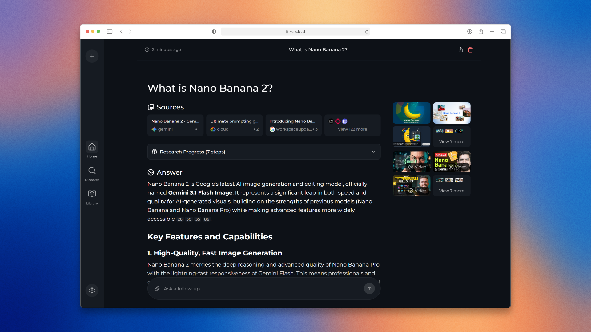

# Vane 🔍

[](https://github.com/module195/Vane/stargazers)
[](https://github.com/module195/Vane/network/members)
[](https://github.com/module195/Vane/watchers)
[](https://hub.docker.com/r/itzcrazykns1337/vane)
[](https://github.com/module195/Vane/blob/master/LICENSE)
[](https://github.com/module195/Vane/commits/master)
[](https://discord.gg/26aArMy8tT)

Vane is a **privacy-focused AI answering engine** that runs entirely on your own hardware. It combines knowledge from the vast internet with support for **local LLMs** (Ollama) and cloud providers (OpenAI, Claude, Groq), delivering accurate answers with **cited sources**. Your chats, settings and API keys stay on your machine; queries go only to the search engine and model providers you configure (see [Security and privacy](#security-and-privacy)).



Want to know more about its architecture and how it works? You can read it [here](https://github.com/module195/Vane/tree/master/docs/architecture/README.md).

## ✨ Features

🤖 **Support for all major AI providers** - Use local LLMs through Ollama or connect to OpenAI, Anthropic Claude, Google Gemini, Groq, and more. Mix and match models based on your needs.

⚡ **Smart search modes** - Choose Speed Mode when you need quick answers, Balanced Mode for everyday searches, or Quality Mode for deep research.

🧭 **Pick your sources** - Search the web, discussions, or academic papers. More sources and integrations are in progress.

🧩 **Widgets** - Helpful UI cards that show up when relevant, like weather, calculations, stock prices, and other quick lookups.

🔍 **Web search powered by SearxNG** - Access multiple search engines while keeping your identity private. Support for Tavily and Exa coming soon for even better results.

📷 **Image and video search** - Find visual content alongside text results. Search isn't limited to just articles anymore.

📄 **File uploads** - Upload documents and ask questions about them. PDFs, text files, images - Vane understands them all.

🌐 **Search specific domains** - Limit your search to specific websites when you know where to look. Perfect for technical documentation or research papers.

💡 **Smart suggestions** - Get intelligent search suggestions as you type, helping you formulate better queries.

📚 **Discover** - Browse interesting articles and trending content throughout the day. Stay informed without even searching.

🕒 **Search history** - Every search is saved locally so you can revisit your discoveries anytime. Your research is never lost.

✨ **More coming soon** - We're actively developing new features based on community feedback. Join our Discord to help shape Vane's future!

## Sponsors

Vane's development is powered by the generous support of our sponsors. Their contributions help keep this project free, open-source, and accessible to everyone.

We'd like to thank the following partners for their generous support:

<table>
  <tr>
    <td width="100" align="center">
      <a href="https://dashboard.exa.ai" target="_blank">
        
      </a>
    </td>
    <td>
      <a href="https://dashboard.exa.ai">Exa</a> • The Perfect Web Search API for LLMs - web search, crawling, deep research, and answer APIs
    </td>
  </tr>
</table>

## Installation

There are mainly 2 ways of installing Vane - With Docker, Without Docker. Using Docker is highly recommended.

### Getting Started with Docker (Recommended)

Vane can be easily run using Docker. Simply run the following command:

```bash
docker run -d -p 127.0.0.1:3000:3000 -v vane-data:/home/vane/data --name vane itzcrazykns1337/vane:latest
```

`127.0.0.1:` keeps Vane reachable only from this computer. Vane has no login, so read [Expose Vane to network](#expose-vane-to-network) before publishing it to other devices.

This will pull and start the Vane container with the bundled SearxNG search engine. Once running, open your browser and navigate to http://localhost:3000. You can then configure your settings (API keys, models, etc.) directly in the setup screen.

**Note**: The image includes both Vane and SearxNG, so no additional setup is required. The `-v` flags create persistent volumes for your data and uploaded files.

**Backups**: the database runs in SQLite WAL mode, so recent changes may still be in `db.sqlite-wal`. Back up the whole data folder (or `db.sqlite` together with `db.sqlite-wal` and `db.sqlite-shm`), ideally with Vane stopped.

#### Using Vane with Your Own SearxNG Instance

If you already have SearxNG running, you can use the slim version of Vane:

```bash
docker run -d -p 3000:3000 -e SEARXNG_API_URL=http://your-searxng-url:8080 -v vane-data:/home/vane/data --name vane itzcrazykns1337/vane:slim-latest
```

**Important**: Make sure your SearxNG instance has:

- JSON format enabled in the settings
- Wolfram Alpha search engine enabled

Replace `http://your-searxng-url:8080` with your actual SearxNG URL. Then configure your AI provider settings in the setup screen at http://localhost:3000.

#### Reading Web Pages with Firecrawl

Vane reads full web pages when you ask it about a specific URL and in **Quality** mode. It does not ship a headless browser. Instead:

- If `FIRECRAWL_API_URL` is set, pages are fetched through [Firecrawl](https://github.com/firecrawl/firecrawl) (`POST /v2/scrape`, markdown output, 60 s timeout per page). This works with Firecrawl Cloud or a self-hosted instance and handles JavaScript-heavy sites.
- If it is not set, Vane falls back to a plain HTTP fetch plus [Readability](https://github.com/mozilla/readability). This needs no extra service but does not run JavaScript, so some dynamic pages may come back empty.

A page that fails or times out is skipped and the answer is built from the other results.

| Variable            | Required | Description                                                                                                                          |
| ------------------- | -------- | ------------------------------------------------------------------------------------------------------------------------------------ |
| `FIRECRAWL_API_URL` | No       | Base URL of your Firecrawl API, without `/v2`. For example `https://api.firecrawl.dev` or `http://host.docker.internal:3002`.        |
| `FIRECRAWL_API_KEY` | No       | Sent as `Authorization: Bearer <key>`. Needed for Firecrawl Cloud; leave it unset for a self-hosted instance without authentication. |

Web searches made during research are throttled to `SEARCH_CONCURRENCY` at a time (default `2`) so a burst of queries does not trip SearXNG's bot detection or upstream rate limits. A search that fails with 403, 429, 502, 503, 504 or a timeout is retried twice (after 1 s and 3 s, or the server's `Retry-After` up to 10 s), and a query that still fails is skipped instead of aborting the research.

Example `docker-compose.yaml` that builds the slim image and uses SearxNG, LM Studio and Firecrawl running on the host:

```yaml
services:
  vane:
    build:
      context: https://github.com/module195/Vane.git#master
      dockerfile: Dockerfile.slim
    image: vane:local
    pull_policy: build
    container_name: vane
    restart: unless-stopped
    ports:
      - '3003:3000'
    environment:
      SEARXNG_API_URL: http://host.docker.internal:8081
      LM_STUDIO_BASE_URL: http://host.docker.internal:1234/v1
      FIRECRAWL_API_URL: http://host.docker.internal:3002
      # FIRECRAWL_API_KEY: fc-...   # only if your Firecrawl requires a key
    extra_hosts:
      - 'host.docker.internal:host-gateway'
    volumes:
      - vane-data:/home/vane/data

volumes:
  vane-data:
```

If Firecrawl runs in another Compose project, you can also attach both to the same Docker network and point `FIRECRAWL_API_URL` at the Firecrawl API service name instead of `host.docker.internal`.

#### Context window

Vane keeps each prompt inside the model's context window. Before every research step it estimates the prompt size; above 75% of the budget it replaces older tool results with a one-line stub (titles and URLs only), and before the answer it trims the sources to what fits, keeping their order so citations stay correct. Nothing changes while the prompt is small.

The window is taken from the provider when it can tell (Ollama: `OLLAMA_NUM_CTX`; LM Studio: the context length the model is loaded with), otherwise 32,000 tokens.

| Variable             | Required | Description                                                                                                    |
| -------------------- | -------- | -------------------------------------------------------------------------------------------------------------- |
| `LLM_CONTEXT_WINDOW` | No       | Context window in tokens to plan against, for any provider. Overrides what the provider reports. E.g. `16384`. |

#### Searching with Firecrawl instead of SearxNG

Web searches use SearxNG by default. To run them through Firecrawl's `POST /v2/search` instead, pick **Firecrawl** under **Settings > Search > Search Provider** (the **Firecrawl URL** field there must be filled), or set `SEARCH_PROVIDER=firecrawl` before the first start.

| Variable          | Required | Description                                                                                        |
| ----------------- | -------- | -------------------------------------------------------------------------------------------------- |
| `SEARCH_PROVIDER` | No       | `searxng` (default) or `firecrawl`. Only seeds the setting; after that, change it in the Settings. |

Notes:

- Vane asks Firecrawl only for result snippets (no page scraping), 10 results per query.
- Self-hosted Firecrawl has no search index of its own: it queries SearxNG when `SEARXNG_ENDPOINT` is set in Firecrawl, and DuckDuckGo otherwise.
- Discussion (Reddit) searches add `site:reddit.com` to the query, and academic searches use Firecrawl's `research` category.
- Image search, video search and Discover still use SearxNG.

#### Using a Bifrost gateway (models and MCP tools)

[Bifrost](https://github.com/maximhq/bifrost) is an OpenAI-compatible gateway in front of many model providers, with its own MCP gateway. Vane can use it in two ways, both off by default and set under **Settings > Bifrost**:

- **Use Bifrost** adds a **Bifrost** provider to the model picker. Its models come from the gateway's `GET /v1/models` and keep Bifrost's `provider/model` names (for example `anthropic/claude-sonnet-4-5`). Chat and embeddings go to `<Bifrost URL>/v1`.
- **Use Bifrost MCP tools** lets the researcher call the tools of the MCP servers connected to Bifrost, through its `/mcp` endpoint. Each tool becomes a researcher tool named `mcp_<tool>`, and its result (capped at 8,000 characters) is used as a source. Tools run only during research, so a question the classifier answers without searching won't call them.

Only tools marked read-only by their server are used, unless you list tools in **Allowed MCP tools** (comma-separated, `*` as a wildcard, for example `brave-*,github-search_code`). Listed tools are used even when they are not read-only, so list only tools you are happy for the model to run without asking.

Chat requests from Vane send `x-bf-mcp-include-tools: vane-no-injected-tools`, so Bifrost doesn't attach MCP tools to them on its own; Vane passes the tools it wants itself. You can also turn on **Disable Auto Tool Injection** in Bifrost.

| Variable              | Required | Description                                                                             |
| --------------------- | -------- | --------------------------------------------------------------------------------------- |
| `BIFROST_ENABLED`     | No       | `true` turns on the Bifrost provider.                                                   |
| `BIFROST_URL`         | No       | Base URL of the gateway, without `/v1`. For example `http://host.docker.internal:8080`. |
| `BIFROST_VIRTUAL_KEY` | No       | Sent as `x-bf-vk` when your gateway requires a virtual key.                             |
| `BIFROST_MCP_ENABLED` | No       | `true` lets the researcher use Bifrost's MCP tools.                                     |
| `BIFROST_MCP_TOOLS`   | No       | Allowed MCP tools, comma-separated with `*` wildcards.                                  |

These variables only seed the settings on the first start; after that, change them in the Settings.

#### Advanced Setup (Building from Source)

If you prefer to build from source or need more control:

1. Ensure Docker is installed and running on your system.
2. Clone the Vane repository:

   ```bash
   git clone https://github.com/module195/Vane.git
   ```

3. After cloning, navigate to the directory containing the project files.

4. Build and run using Docker:

   ```bash
   docker build -t vane .
   docker run -d -p 3000:3000 -v vane-data:/home/vane/data --name vane vane
   ```

5. Access Vane at http://localhost:3000 and configure your settings in the setup screen.

**Note**: After the containers are built, you can start Vane directly from Docker without having to open a terminal.

### Non-Docker Installation

1. Install SearXNG and allow `JSON` format in the SearXNG settings. Make sure Wolfram Alpha search engine is also enabled.
2. Clone the repository:

   ```bash
   git clone https://github.com/module195/Vane.git
   cd Vane
   ```

3. Install dependencies:

   ```bash
   npm i
   ```

4. Build the application:

   ```bash
   npm run build
   ```

5. Start the application:

   ```bash
   npm run start
   ```

6. Open your browser and navigate to http://localhost:3000 to complete the setup and configure your settings (API keys, models, SearxNG URL, etc.) in the setup screen.

**Note**: Using Docker is recommended as it simplifies the setup process, especially for managing environment variables and dependencies.

See the [installation documentation](https://github.com/module195/Vane/tree/master/docs/installation) for more information like updating, etc.

### Troubleshooting

#### Local OpenAI-API-Compliant Servers

If Vane tells you that you haven't configured any chat model providers, ensure that:

1. Your server is running on `0.0.0.0` (not `127.0.0.1`) and on the same port you put in the API URL.
2. You have specified the correct model name loaded by your local LLM server.
3. You have specified the correct API key, or if one is not defined, you have put _something_ in the API key field and not left it empty.

#### Ollama Connection Errors

If you're encountering an Ollama connection error, it is likely due to the backend being unable to connect to Ollama's API. To fix this issue you can:

1. **Check your Ollama API URL:** Ensure that the API URL is correctly set in the settings menu.
2. **Update API URL Based on OS:**
   - **Windows:** Use `http://host.docker.internal:11434`
   - **Mac:** Use `http://host.docker.internal:11434`
   - **Linux:** Use `http://<private_ip_of_host>:11434`

   Adjust the port number if you're using a different one.

3. **Linux Users - Expose Ollama to Network:**
   - Inside `/etc/systemd/system/ollama.service`, you need to add `Environment="OLLAMA_HOST=0.0.0.0:11434"`. (Change the port number if you are using a different one.) Then reload the systemd manager configuration with `systemctl daemon-reload`, and restart Ollama by `systemctl restart ollama`. For more information see [Ollama docs](https://github.com/ollama/ollama/blob/main/docs/faq.md#setting-environment-variables-on-linux)

   - Ensure that the port (default is 11434) is not blocked by your firewall.

#### Lemonade Connection Errors

If you're encountering a Lemonade connection error, it is likely due to the backend being unable to connect to Lemonade's API. To fix this issue you can:

1. **Check your Lemonade API URL:** Ensure that the API URL is correctly set in the settings menu.
2. **Update API URL Based on OS:**
   - **Windows:** Use `http://host.docker.internal:8000`
   - **Mac:** Use `http://host.docker.internal:8000`
   - **Linux:** Use `http://<private_ip_of_host>:8000`

   Adjust the port number if you're using a different one.

3. **Ensure Lemonade Server is Running:**
   - Make sure your Lemonade server is running and accessible on the configured port (default is 8000).
   - Verify that Lemonade is configured to accept connections from all interfaces (`0.0.0.0`), not just localhost (`127.0.0.1`).
   - Ensure that the port (default is 8000) is not blocked by your firewall.

## Using as a Search Engine

If you wish to use Vane as an alternative to traditional search engines like Google or Bing, or if you want to add a shortcut for quick access from your browser's search bar, follow these steps:

1. Open your browser's settings.
2. Navigate to the 'Search Engines' section.
3. Add a new site search with the following URL: `http://localhost:3000/?q=%s`. Replace `localhost` with your IP address or domain name, and `3000` with the port number if Vane is not hosted locally.
4. Click the add button. Now, you can use Vane directly from your browser's search bar.

## Using Vane's API

Vane also provides an API for developers looking to integrate its powerful search engine into their own applications. You can run searches, use multiple models and get answers to your queries.

For more details, check out the full documentation [here](https://github.com/module195/Vane/tree/master/docs/API/SEARCH.md).

## Expose Vane to network

Vane has **no login**: anyone who can reach its port can read your chats and use your configured models. The Docker examples bind to `127.0.0.1` for that reason. To use Vane from other devices, publish the port on all interfaces (`-p 3000:3000`) only on a network you trust, or put it behind a reverse proxy that adds authentication.

Local names (`localhost`, IP addresses, single-label names such as `vane`, and `.local`/`.lan`/`.internal`/`.home.arpa` hosts) work out of the box. If you reach Vane through a public domain name, add it to `VANE_ALLOWED_HOSTS` (comma-separated, `*.example.com` wildcards allowed), otherwise the API answers `403`:

```bash
docker run -d -p 3000:3000 -e VANE_ALLOWED_HOSTS=vane.example.com -v vane-data:/home/vane/data --name vane itzcrazykns1337/vane:latest
```

## Security and privacy

- **Requests from other web sites are refused.** The API only accepts changes (POST, PATCH, DELETE) from Vane's own page and ignores unknown host names, so a page you visit cannot reconfigure Vane or read it through DNS rebinding.
- **API keys are never sent back to the browser.** The settings screen shows `••••••••` for saved keys; leave it as is to keep the stored key.
- **The researcher cannot read your network.** Pages the model asks to read must resolve to public addresses, so a malicious page cannot make Vane fetch `localhost`, your LAN or cloud metadata. Set `VANE_ALLOW_PRIVATE_URLS=true` if you want it to read intranet pages.
- **Answers cannot load remote content.** HTML and images written by the model are shown as text or links, never loaded automatically.
- **Third parties:** favicons are fetched by the Vane server (only the site's domain is used). The weather widget looks up your city on the server with coordinates rounded to about 1 km (BigDataCloud) or from the server's IP (freeipapi.com), and gets the forecast from Open-Meteo. Turn the widget off in Settings to avoid these lookups.

## One-Click Deployment

[](https://usw.sealos.io/?openapp=system-template%3FtemplateName%3Dperplexica)
[](https://repocloud.io/details/?app_id=267)
[](https://template.run.claw.cloud/?referralCode=U11MRQ8U9RM4&openapp=system-fastdeploy%3FtemplateName%3Dperplexica)
[](https://www.hostinger.com/vps/docker-hosting?compose_url=https://raw.githubusercontent.com/module195/Vane/refs/heads/master/docker-compose.yaml)

## Upcoming Features

- [ ] Adding more widgets, integrations, search sources
- [ ] Adding ability to create custom agents (name T.B.D.)
- [ ] Adding authentication

## Support Us

If you find Vane useful, consider giving us a star on GitHub. This helps more people discover Vane and supports the development of new features. Your support is greatly appreciated.

### Donations

We also accept donations to help sustain our project. If you would like to contribute, you can use the following options to donate. Thank you for your support!

| Ethereum                                              |
| ----------------------------------------------------- |
| Address: `0xB025a84b2F269570Eb8D4b05DEdaA41D8525B6DD` |

## Contribution

Vane is built on the idea that AI and large language models should be easy for everyone to use. If you find bugs or have ideas, please share them in via GitHub Issues. For more information on contributing to Vane you can read the [CONTRIBUTING.md](CONTRIBUTING.md) file to learn more about Vane and how you can contribute to it.

## Help and Support

If you have any questions or feedback, please feel free to reach out to us. You can create an issue on GitHub or join our Discord server. There, you can connect with other users, share your experiences and reviews, and receive more personalized help. [Click here](https://discord.gg/EFwsmQDgAu) to join the Discord server. To discuss matters outside of regular support, feel free to contact me on Discord at `itzcrazykns`.

Thank you for exploring Vane, the AI-powered search engine designed to enhance your search experience. We are constantly working to improve Vane and expand its capabilities. We value your feedback and contributions which help us make Vane even better. Don't forget to check back for updates and new features!
