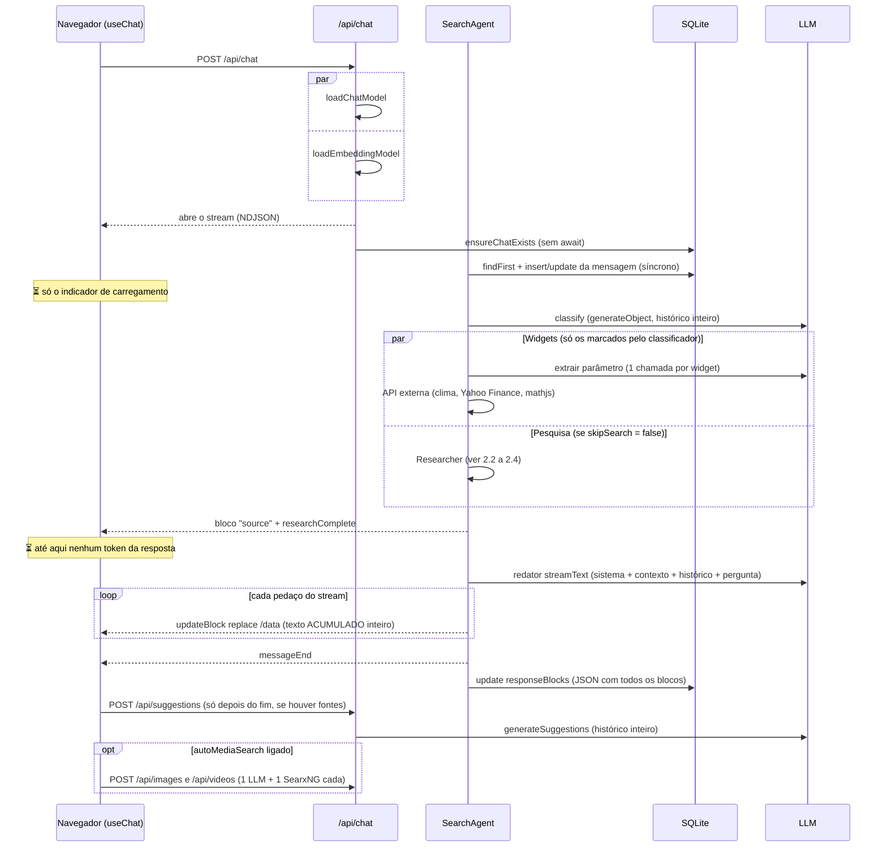
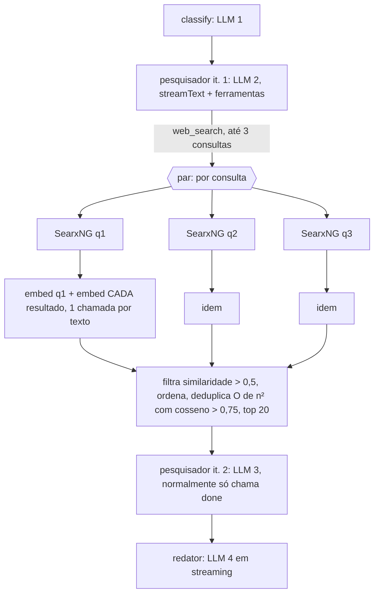
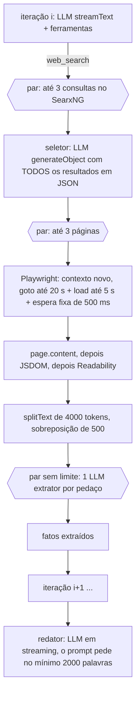

# Vane: arquitetura e fluxo de uma busca (Fase 1 da auditoria de desempenho)

Base analisada: `master` em `3e08f83`, que já inclui os PRs #1 (tradução pt-BR), #2 (correções de segurança) e #3 (nove correções do upstream). Branch de trabalho: `claude/project-thread-bivz3o`.

Legenda dos diagramas: setas são etapas em sequência; blocos `par` rodam em paralelo; ⏳ marca onde a interface fica esperando sem receber conteúdo novo.

## 1. Visão geral

| Peça                                 | Onde                                                               | Observação                                                                                                                                                                                                                                    |
| ------------------------------------ | ------------------------------------------------------------------ | --------------------------------------------------------------------------------------------------------------------------------------------------------------------------------------------------------------------------------------------- |
| Rota do chat                         | `src/app/api/chat/route.ts:103`                                    | Valida, carrega os modelos em paralelo, cria a sessão e devolve o stream NDJSON na hora. O agente roda em segundo plano.                                                                                                                      |
| Orquestrador                         | `src/lib/agents/search/index.ts:28`                                | Classificação, depois widgets e pesquisa em paralelo, depois o redator.                                                                                                                                                                       |
| Classificador                        | `src/lib/agents/search/classifier.ts:37`                           | 1 chamada LLM em JSON. Decide `skipSearch`, fontes e widgets, e reescreve a pergunta.                                                                                                                                                         |
| Pesquisador (agente com ferramentas) | `src/lib/agents/search/researcher/index.ts:59`                     | Laço de até 2, 6 ou 25 iterações (speed, balanced, quality). Cada iteração é 1 chamada LLM com ferramentas.                                                                                                                                   |
| Busca                                | `src/lib/agents/search/researcher/actions/search/baseSearch.ts:12` | SearxNG + embeddings (speed e balanced) ou SearxNG + seletor LLM + Playwright + extrator LLM (quality).                                                                                                                                       |
| Redator                              | `src/lib/agents/search/index.ts:143`                               | 1 chamada LLM em streaming, com todo o contexto no prompt de sistema.                                                                                                                                                                         |
| Sessão e stream                      | `src/lib/session.ts`                                               | Guarda os blocos e **todos** os eventos por 30 min, para permitir reconexão (`/api/reconnect/[id]`).                                                                                                                                          |
| Banco                                | `src/lib/db`                                                       | **SQLite** via `better-sqlite3` + Drizzle (`data/db.sqlite`). Tabelas `chats` e `messages`, sem índices além das chaves primárias.                                                                                                            |
| Modelos                              | `src/lib/models/providers`                                         | OpenAI, Anthropic, Gemini, Groq, Lemonade e LM Studio passam todos pela classe `OpenAILLM` (SDK `openai`, endpoint compatível). Ollama tem cliente próprio. Embeddings: OpenAI, Gemini, Ollama, Lemonade, LM Studio ou Transformers.js local. |

Um único modelo de chat, escolhido pelo usuário, atende **todas** as etapas: classificação, pesquisa, seleção, extração, widgets, redação, sugestões e mídia. Não existe modelo por etapa.

## 2. Fluxo por modo

### 2.1 Comum aos três modos (antes e depois da pesquisa)

Pontos importantes:

- O tempo até o primeiro token (TTFT) é a soma, em sequência, de: classificação + pesquisa inteira (ou o widget mais lento, se for mais lento que a pesquisa) + TTFT do redator.
- Quando a busca é pulada (`skipSearch`), o widget mais lento vira o caminho crítico.
- Durante a pesquisa a interface recebe os passos intermediários (plano, consultas, fontes lidas), mas nenhum texto da resposta.
- As sugestões só começam depois do `messageEnd`, numa requisição separada do navegador.
- Se o usuário fecha a página, a rota só desliga o listener (`route.ts:235`). O agente continua até o fim: LLM, Playwright e gravação no banco. Isso é em parte intencional, porque `/api/reconnect` permite retomar a resposta depois de recarregar a página.

### 2.2 Speed (no máximo 2 iterações do pesquisador, sem a ferramenta de plano)

- Não baixa páginas: usa só os trechos (`content`) que o SearxNG devolve.
- Embeddings: com 3 consultas de cerca de 20 resultados cada, são cerca de 63 chamadas de embedding feitas uma a uma (em paralelo), embora todas as APIs aceitem lote.
- A 2ª iteração do pesquisador costuma servir só para chamar `done`, mas reenvia todos os resultados da 1ª em JSON.

### 2.3 Balanced (até 6 iterações, com `__reasoning_preamble`)

Igual ao speed na busca (só trechos + embeddings), mas:

- cada iteração é uma chamada LLM que reenvia o histórico inteiro do agente, incluindo cada resultado anterior serializado em JSON (`researcher/index.ts:180`). O custo de entrada cresce de forma quadrática com o número de iterações;
- o modelo é instruído a chamar o plano antes de cada ação, então há normalmente de 2 a 4 iterações com busca e 1 com `done`;
- as iterações são em sequência; as ferramentas de uma mesma iteração rodam em paralelo (`registry.ts:93`).

### 2.4 Quality (até 25 iterações; baixa e extrai páginas)

- O prompt manda fazer pelo menos 5 a 6 iterações de busca. Uma busca típica faz de 6 a 12 iterações; o teto é 25.
- Por iteração com busca: 1 LLM do pesquisador + 1 seletor + (1 a 3 páginas × N pedaços) extratores. Uma página longa de 20 mil tokens gera 6 extratores.
- Uma página lenta segura a iteração inteira por até cerca de 25,5 s. Não há limite de tamanho da página nem de concorrência de páginas entre buscas simultâneas.
- O HTML é processado duas vezes: o Chromium monta o DOM e depois o JSDOM monta de novo para o Readability.
- O mesmo URL não é lido de novo na mesma busca (`baseSearch.ts:290`), mas não há cache entre buscas.

### 2.5 Ferramentas que valem em qualquer modo

- `scrape_url` (`scrapeURL.ts:84`): só quando o usuário pede um URL. Mesmo Playwright, com extrator por pedaço se a página passar de 4000 tokens.
- `academic_search`: mesmo caminho do `web_search`, com os motores arxiv, google scholar e pubmed.
- `social_search`: motor reddit.
- `uploads_search`: ver 3.1.
- **Busca restrita por domínio**: não existe recurso dedicado no código. Só funciona quando o usuário escreve `site:dominio` e o pesquisador mantém isso na consulta enviada ao SearxNG.

## 3. Outros recursos

### 3.1 Upload de arquivos

- `POST /api/uploads` chama `UploadManager.processFiles` (`src/lib/uploads/manager.ts:174`): grava o arquivo, extrai o texto (TXT; PDF com `pdf-parse`; DOCX com `officeparser`), divide em pedaços de 512 tokens com 128 de sobreposição e calcula todos os embeddings numa única chamada. Grava um `.content.json` indentado (texto + vetores) e atualiza um JSON de registro.
- Tipos aceitos hoje: PDF, DOCX e TXT. **Imagens não são aceitas**, ao contrário do que diz a descrição do projeto.
- Consulta (`src/lib/uploads/store.ts:53`): a cada chamada da ferramenta, lê e faz o parse síncrono de todos os `.content.json`, calcula o embedding das consultas (1 chamada em lote), compara com todos os pedaços e combina por RRF (k = 60). O hash usado para juntar o mesmo pedaço entre consultas (`hashObj`) só considera a nota: o filtro de chaves do `JSON.stringify` também apaga os campos internos do pedaço. Na prática, pedaços diferentes com a mesma nota viram um só (os outros somem do resultado), e o mesmo pedaço vindo de duas consultas nunca é somado. O teste `src/lib/uploads/__tests__/store.test.ts` mostra o caso. É um bug de qualidade, não só de desempenho.
- O prompt do pesquisador inclui os 3 primeiros pedaços de cada arquivo em toda iteração, relendo os arquivos do disco a cada iteração (`researcher.ts:332`).

### 3.2 Discover

- `GET /api/discover` (`src/app/api/discover/route.ts:28`): no modo normal faz 3 sites × 4 consultas = 12 buscas no SearxNG em paralelo (motor bing news), sem cache, e embaralha o resultado. Sem LLM.

### 3.3 Widgets

- Clima, cotação e cálculo: 1 chamada LLM cada para extrair o parâmetro (com o histórico inteiro, sem corte) + API externa (Open-Meteo, Yahoo Finance com 4 a 6 gráficos, mathjs).
- O widget de clima da página inicial usa `/api/weather` direto, sem LLM.

### 3.4 Histórico

- Lista (`/api/chats`): carrega **todas** as conversas e inverte a ordem em memória, sem paginação.
- Conversa (`/api/chats/[id]`): carrega todas as mensagens com o JSON completo de `responseBlocks`, que inclui todos os passos da pesquisa e todos os trechos lidos. `messages.chatId` não tem índice.
- Escritas: 1 insert ou update antes da classificação (pequeno e síncrono) e 1 update com todos os blocos depois do fim do stream (fora do caminho do TTFT).

### 3.5 API de busca (`POST /api/search`, `docs/API/SEARCH.md`)

- Mesmo pipeline via `APISearchAgent` (`src/lib/agents/search/api.ts`), sem banco e sem uploads, com stream opcional. Mesmas chamadas LLM do chat, menos as sugestões.

### 3.6 Imagens e vídeos

- `/api/images` e `/api/videos`: 1 LLM para gerar a consulta (com exemplos few-shot e o histórico inteiro) + 1 SearxNG.

## 4. Inventário de chamadas a LLM e a embeddings

Configuração comum a todas as chamadas de chat:

- **Modelo**: o modelo de chat escolhido pelo usuário, o mesmo para todas as etapas.
- **Temperatura**: nenhuma chamada passa `options`. Vale o padrão do código: **1,0** em `OpenAILLM` (`openaiLLM.ts:91`, enviado explicitamente a todos os provedores pagos) e **0,7** em `OllamaLLM` (`ollamaLLM.ts:100`).
- **max_tokens**: nunca é definido (`max_completion_tokens` e `num_predict` vão vazios). Vale o limite de cada provedor.
- **Contexto no Ollama**: `num_ctx` vem de `OLLAMA_NUM_CTX` (`ollamaLLM.ts:23`). Não há `keep_alive`. `think: false` é enviado aos modelos de raciocínio conhecidos.
- **Uso de tokens**: o campo `usage` nunca é lido. Os streams da OpenAI não pedem `stream_options.include_usage`.
- **Cache de prompt**: nenhum marcador. A Anthropic é usada pelo endpoint compatível com OpenAI, que não aceita `cache_control`.

Tamanho dos prompts fixos, em tokens cl100k medidos no código: classificador cerca de 1,2 mil; pesquisador cerca de 0,8 mil (speed), 1,3 mil (balanced) e 1,8 mil (quality), mais de 0,3 a 0,5 mil por ferramenta descrita; redator cerca de 1,1 mil + contexto; seletor cerca de 0,5 mil; extrator cerca de 0,6 mil; sugestões cerca de 0,2 mil.

| #   | Arquivo:linha                                                       | Etapa                                      | Prompt de sistema                                                                                    | Streaming                     | Saída                  | Chamadas por busca                                              |
| --- | ------------------------------------------------------------------- | ------------------------------------------ | ---------------------------------------------------------------------------------------------------- | ----------------------------- | ---------------------- | --------------------------------------------------------------- |
| 1   | `src/lib/agents/search/classifier.ts:38`                            | Classificação e reescrita da pergunta      | `classifierPrompt` (`src/lib/prompts/search/classifier.ts:1`)                                        | não                           | JSON                   | 1                                                               |
| 2   | `src/lib/agents/search/researcher/index.ts:68`                      | Pesquisador (escolha de ferramentas)       | `getResearcherPrompt` (`src/lib/prompts/search/researcher.ts:323`) + descrições das ferramentas      | sim (só para mostrar o plano) | chamadas de ferramenta | speed ≤ 2, balanced ≤ 6, quality ≤ 25                           |
| 3   | `src/lib/agents/search/researcher/actions/search/baseSearch.ts:272` | Seletor de resultados (só quality)         | `pickerPrompt` (`baseSearch.ts:229`)                                                                 | não                           | JSON                   | 1 por chamada de busca                                          |
| 4   | `src/lib/agents/search/researcher/actions/search/baseSearch.ts:382` | Extrator de fatos das páginas (só quality) | `extractorPrompt` (`baseSearch.ts:312`)                                                              | não                           | JSON                   | 1 por pedaço de 4000 tokens, até 3 páginas por chamada de busca |
| 5   | `src/lib/agents/search/researcher/actions/scrapeURL.ts:155`         | Extrator para URL pedido pelo usuário      | `extractorPrompt` (`scrapeURL.ts:7`, cópia do nº 4)                                                  | não                           | JSON                   | 1 por pedaço, só se a página passar de 4000 tokens              |
| 6   | `src/lib/agents/search/index.ts:143`                                | Redator (chat)                             | `getWriterPrompt` (`src/lib/prompts/search/writer.ts:1`), com o contexto dentro do prompt de sistema | sim                           | texto                  | 1                                                               |
| 7   | `src/lib/agents/search/api.ts:78`                                   | Redator (API de busca)                     | igual ao nº 6                                                                                        | sim                           | texto                  | 1                                                               |
| 8   | `src/lib/agents/search/widgets/weatherWidget.ts:58`                 | Widget de clima                            | `systemPrompt` do arquivo                                                                            | não                           | JSON                   | 0 ou 1                                                          |
| 9   | `src/lib/agents/search/widgets/stockWidget.ts:56`                   | Widget de cotação                          | `systemPrompt` do arquivo                                                                            | não                           | JSON                   | 0 ou 1                                                          |
| 10  | `src/lib/agents/search/widgets/calculationWidget.ts:40`             | Widget de cálculo                          | `system` do arquivo                                                                                  | não                           | JSON                   | 0 ou 1                                                          |
| 11  | `src/lib/agents/suggestions/index.ts:21`                            | Sugestões de perguntas                     | `suggestionGeneratorPrompt` (`src/lib/prompts/suggestions/index.ts:1`)                               | não                           | JSON                   | 1 (pedida pelo navegador depois da resposta)                    |
| 12  | `src/lib/agents/media/image.ts:32`                                  | Consulta para busca de imagens             | `imageSearchPrompt` + few-shot (`src/lib/prompts/media/image.ts`)                                    | não                           | JSON                   | 0 ou 1, sob demanda                                             |
| 13  | `src/lib/agents/media/video.ts:31`                                  | Consulta para busca de vídeos              | `videoSearchPrompt` + few-shot (`src/lib/prompts/media/videos.ts`)                                   | não                           | JSON                   | 0 ou 1, sob demanda                                             |

Temperatura e `max_tokens` são iguais em todas as linhas: temperatura 1,0 (OpenAI e compatíveis) ou 0,7 (Ollama), e `max_tokens` sem limite.

Embeddings (modelo de embedding escolhido pelo usuário):

| #   | Arquivo:linha                                   | Etapa                                                     | Em lote?                     | Chamadas por busca                                     |
| --- | ----------------------------------------------- | --------------------------------------------------------- | ---------------------------- | ------------------------------------------------------ |
| E1  | `baseSearch.ts:51`                              | Embedding da consulta (speed e balanced)                  | 1 texto                      | 1 por consulta                                         |
| E2  | `baseSearch.ts:58`                              | Embedding de cada resultado do SearxNG (speed e balanced) | **não, 1 texto por chamada** | cerca de 20 por consulta, até cerca de 60 por iteração |
| E3  | `src/lib/uploads/store.ts:54`                   | Embedding das consultas nos arquivos                      | sim                          | 1 por chamada da ferramenta                            |
| E4  | `src/lib/uploads/manager.ts:95`, `:126`, `:152` | Embedding dos pedaços no upload (TXT, PDF, DOCX)          | sim, todos numa chamada só   | por upload                                             |

Chamadas LLM típicas por busca (estimativa pelo código; a Fase 3 vai medir):

| Modo     | Classificador | Pesquisador | Seletor | Extrator | Redator | Sugestões | Total             |
| -------- | ------------- | ----------- | ------- | -------- | ------- | --------- | ----------------- |
| Speed    | 1             | 2           | 0       | 0        | 1       | 1         | cerca de 5        |
| Balanced | 1             | 3 a 6       | 0       | 0        | 1       | 1         | cerca de 6 a 9    |
| Quality  | 1             | 6 a 25      | 3 a 12  | 10 a 100 | 1       | 1         | cerca de 25 a 140 |

Mais 1 por widget acionado.

## 5. Observações para as próximas fases (ainda sem medição)

Anoto o que vi lendo o código, para guiar o benchmark. Nada foi alterado, e cada item precisa de medição antes de virar mudança.

1. **Stream quadrático**: cada pedaço do redator envia o texto acumulado inteiro (`index.ts:174`), e a sessão guarda todos esses eventos por 30 min (`session.ts:28`). Numa resposta de 3 mil tokens isso pode chegar a dezenas de MB trafegados e guardados por resposta. O navegador aplica um patch e recria a lista de mensagens a cada token (`useChat.tsx:610`).
2. **Embeddings um a um** no speed e no balanced (`baseSearch.ts:58`), embora todos os provedores aceitem lote.
3. **Prefixo instável no pesquisador**: a data e o número da iteração estão nas primeiras linhas do prompt (`researcher.ts:20-22`), o que impede o cache de prefixo entre iterações (OpenAI, Gemini, Ollama).
4. **Histórico do agente cresce de forma quadrática** no balanced e no quality (resultados inteiros em JSON a cada iteração).
5. **Páginas lentas** seguram a iteração no quality (20 s + 5 s + 0,5 s), e os extratores não têm limite de concorrência.
6. **O trabalho continua depois que a página fecha**, porque não há `AbortController` até o LLM e o Playwright. Isso precisa ser conciliado com a reconexão.
7. **Temperatura 1,0** nas etapas que devolvem JSON, e nenhum `max_tokens`. Mudar isso mexe em qualidade e passa pela avaliação.
8. **Sugestões só depois do fim da resposta**. Poderiam começar em paralelo, desde que usem o mesmo histórico.
9. **Banco**: sem índice em `messages.chatId`, sem WAL, lista de conversas sem paginação. Criar índice é mudança de schema e exige sua aprovação.
10. **Uploads**: leitura e parse síncronos dos JSON a cada iteração e a cada consulta; o hash que só considera a nota descarta pedaços e quebra o RRF.
11. **Build e Docker**: o `.next/standalone` tem 638 MB, dos quais 405 MB são do `onnxruntime-node` (usado só pelos embeddings locais do Transformers.js); entram também as variantes `gnu` e `musl` do `@napi-rs/canvas` e do `sharp`. A imagem completa instala `build-essential`, `git` e bibliotecas de desenvolvimento na imagem final, clona o SearxNG do `HEAD` (não reproduzível) e roda `yarn add playwright` de novo na imagem final.
12. **Front-end**: o maior pedaço de JS do cliente tem 1,1 MB; `jspdf`, `react-syntax-highlighter` e `lightweight-charts` são importados de forma estática; `framer-motion` e `motion` aparecem juntos.

## 6. Estado atual de testes, lint e build

| Verificação                                | Resultado                                                                                                                                                                                       |
| ------------------------------------------ | ----------------------------------------------------------------------------------------------------------------------------------------------------------------------------------------------- |
| Testes automatizados                       | **Não existem**: nenhum arquivo de teste nem script `test`.                                                                                                                                     |
| CI (`.github/workflows/docker-build.yaml`) | Só monta e publica as imagens Docker no push para `master` ou `canary` e em releases. Não roda lint nem testes.                                                                                 |
| `yarn install --frozen-lockfile`           | OK (81 s). Aviso: `eslint-config-next@16.2.2` exige `eslint >= 9`, e o projeto usa `eslint 8`.                                                                                                  |
| `npm run lint`                             | **Quebrado**: o Next 16 removeu o `next lint` (`Invalid project directory provided ... /lint`). Rodar o `eslint` direto também falha, porque o `eslint-config-next` 16 não carrega no ESLint 8. |
| `tsc --noEmit`                             | OK, sem erros.                                                                                                                                                                                  |
| `npm run build`                            | OK em 93 s (webpack, sem cache). 14 páginas geradas; `.next/static` com 4,1 MB; `.next/standalone` com 638 MB. Só avisos (browserslist desatualizado e cache do webpack com `next-intl`).       |
