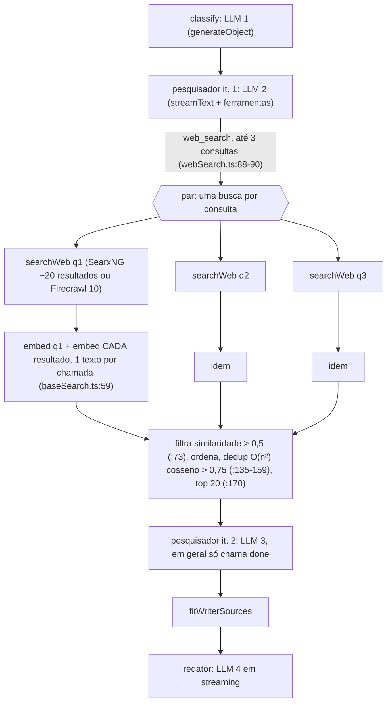
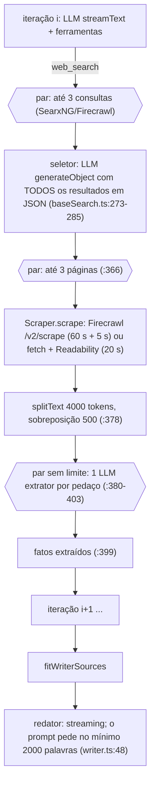
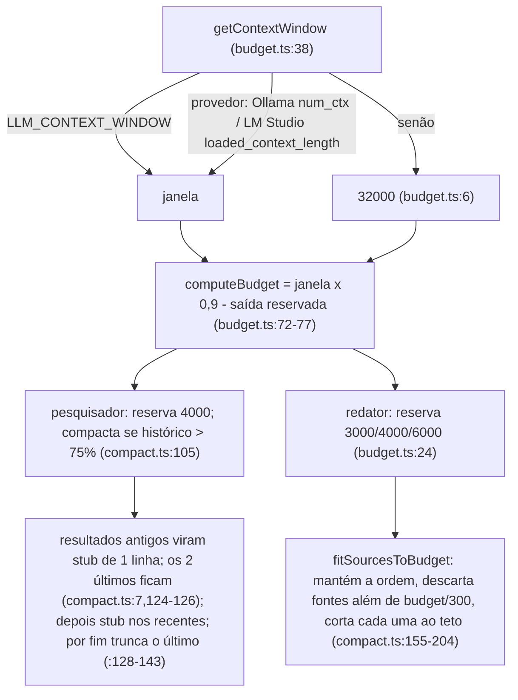
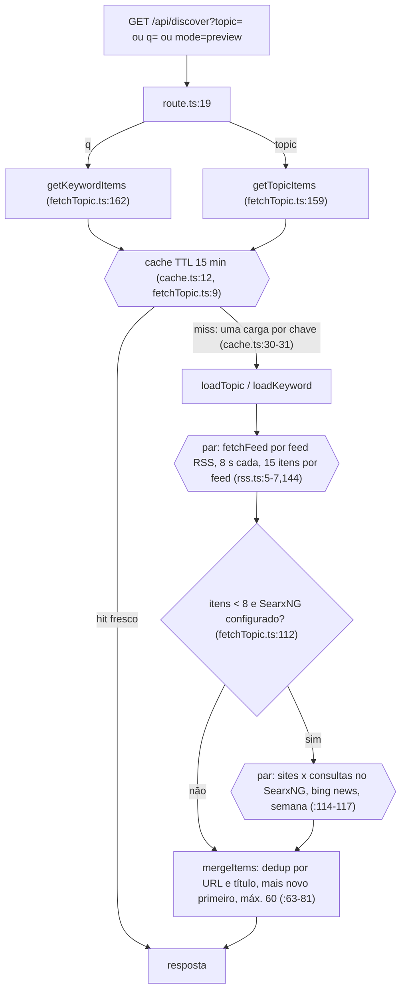
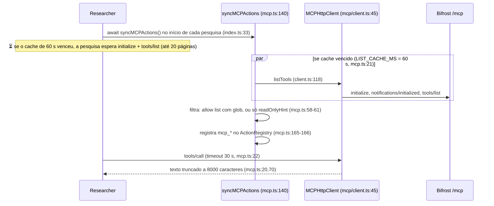
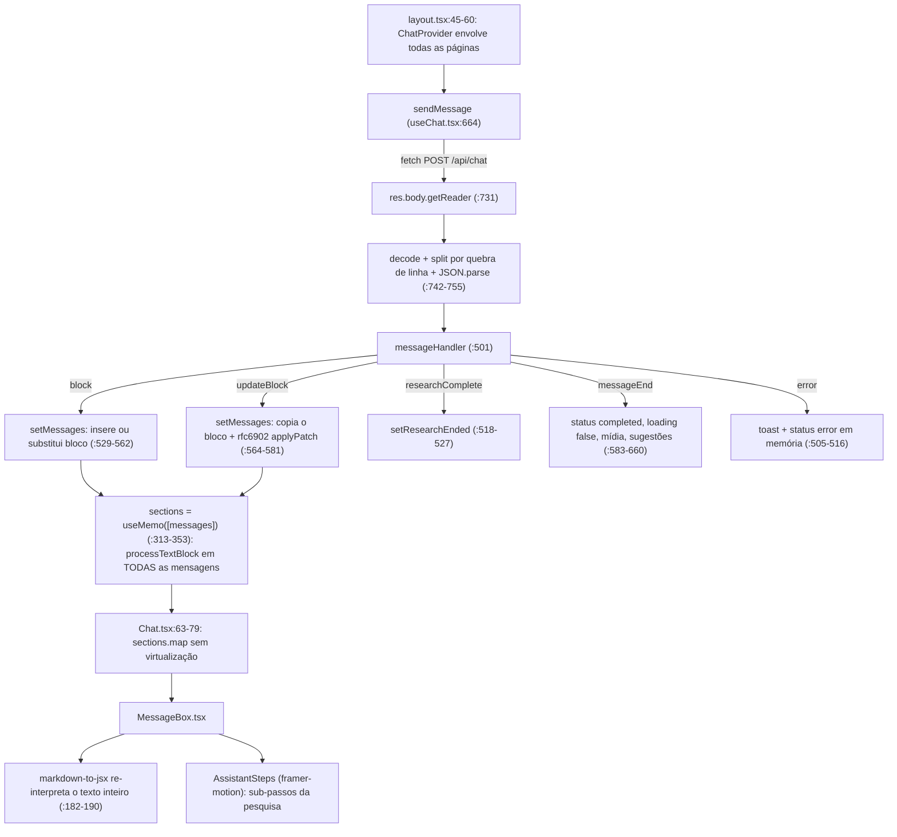

# Vane: arquitetura e fluxo de uma busca (versão atualizada)

Base analisada: `master` em `3b3799c` (PR #13), lido arquivo a arquivo. O doc anterior foi escrito sobre `3e08f83`; desde então entraram os PRs #4 a #13 (84 arquivos de `src/` mudaram). Cada mudança foi conferida contra o código atual.

Legenda dos diagramas: setas são etapas em sequência; blocos `par` rodam em paralelo; ⏳ marca onde a interface fica esperando sem receber conteúdo novo. Referências são `arquivo:linha` no código atual.

## 1. Visão geral

| Peça | Onde | Observação |
|---|---|---|
| Rota do chat | `src/app/api/chat/route.ts:103` | Valida com zod (`:34`), carrega chat e embedding em paralelo (`:130-136`), cria a sessão, dispara o agente sem `await` (`:213`) e devolve o stream NDJSON (`:242`). |
| Orquestrador | `src/lib/agents/search/index.ts:29` | Grava a mensagem, classifica, roda widgets e pesquisa em paralelo, monta o contexto com orçamento, escreve. |
| Classificador | `src/lib/agents/search/classifier.ts:37` | 1 `generateObject`. Decide `skipSearch`, fontes, widgets e devolve `standaloneFollowUp` (pergunta reescrita, `:30-35`). |
| Pesquisador | `src/lib/agents/search/researcher/index.ts:21` | Laço de 2, 6 ou 25 iterações (`:26-31`). Sincroniza ferramentas MCP (`:33`) e compacta o histórico por orçamento (`:96-111`). |
| Ações | `researcher/actions/index.ts:10-16`, `mcp.ts:140` | `web_search`, `academic_search`, `social_search`, `scrape_url`, `uploads_search`, `__reasoning_preamble`, `done`, mais `mcp_*` dinâmicas. |
| Busca | `researcher/actions/search/baseSearch.ts:13` | SearxNG **ou Firecrawl** (`src/lib/webSearch.ts:10`). Speed/balanced usam embeddings; quality usa seletor LLM + leitura de página + extrator LLM. |
| Leitura de páginas | `src/lib/scraper.ts:42` | **Sem Playwright.** Firecrawl `/v2/scrape` se houver URL; senão `fetch` + Readability. |
| Contexto do redator | `src/lib/agents/search/writerContext.ts:22`, `src/lib/context/{budget,compact}.ts` | Corta as fontes para caber na janela. |
| Redator | `src/lib/agents/search/index.ts:163` | 1 chamada em streaming. |
| Sessão e stream | `src/lib/session.ts` | Guarda blocos e **todos** os eventos por 30 min (`:17`) para `/api/reconnect/[id]`. |
| Banco | `src/lib/db/index.ts:7` | SQLite (`better-sqlite3`) + Drizzle, `data/db.sqlite`. Tabelas `chats` e `messages`, sem índices secundários. |
| Config | `src/lib/config/index.ts:525` | Singleton que lê `data/config.json` uma vez (na importação) e regrava o arquivo inteiro a cada mudança. |
| Modelos | `src/lib/models/providers/index.ts:12-21` + Bifrost (`models/registry.ts:45`) | OpenAI, Ollama, Gemini, Transformers (só embeddings), Groq, Lemonade, Anthropic, LM Studio, e Bifrost (acrescentado em tempo de execução). |
| Discover | `src/lib/discover/*` | Reescrito: RSS primeiro, SearxNG de reserva, cache TTL em memória. |
| Benchmark | `src/lib/benchmark/*`, `src/app/api/benchmark/route.ts:27` | Roda casos fixos e mede chamadas LLM, embedding e HTTP. |
| i18n | `src/i18n/*`, `next.config.mjs:5,37` | `next-intl`; locales `pt-BR` (padrão) e `en` (`src/i18n/config.ts:1-4`). |
| Testes | `vitest.config.ts:4-12`, `package.json:12` | Existem testes (vitest). O CI não os roda (seção 12). |

Um único modelo de chat, escolhido pelo usuário, atende **todas** as etapas. Não existe modelo por etapa (inalterado).

## 2. Mapa de rotas e onde cada uma roda

Não existe `export const runtime = 'edge'` em lugar nenhum de `src/`. Só duas rotas declaram runtime, ambas `'nodejs'`: `api/chat/route.ts:13` e `api/benchmark/route.ts:14`. As demais usam o padrão do Next para route handlers (Node.js; padrão do framework, não escrito no repositório). Não há `middleware.ts` nem `proxy.ts`. `instrumentation.ts:2` só executa com `NEXT_RUNTIME === 'nodejs'`.

### 2.1 Páginas

| Rota | Arquivo | Onde roda |
|---|---|---|
| layout raiz | `src/app/layout.tsx:1` (`force-dynamic`) | **Servidor** (async). Lê `configManager.isSetupComplete()` e as seções de config a cada render (`:36-37`); mostra `SetupWizard` (cliente) ou `ChatProvider` + `Sidebar` (`:45-60`). `getLocale` lê o cookie `NEXT_LOCALE` (`i18n/request.ts:6`). |
| `/` | `src/app/page.tsx:10` | Servidor (sem `'use client'`); renderiza `ChatWindow`, que é **cliente**. |
| `/c/[chatId]` | `src/app/c/[chatId]/page.tsx:1` | **Cliente**. |
| `/library` | `src/app/library/page.tsx:1` | **Cliente**; busca `/api/chats` no `useEffect` (`:28`). |
| `/discover` | `src/app/discover/page.tsx:1` | **Cliente**; busca `/api/discover` com `AbortController` (`:110-132`). Tópicos seguidos ficam no navegador (`lib/discover/clientTopics.ts`). |
| `/manifest.webmanifest` | `src/app/manifest.ts` | Servidor (rota de metadados). |

### 2.2 Rotas de API (22 handlers em 17 arquivos; todas Node.js, nenhuma com autenticação)

| Método e caminho | Arquivo | O que faz |
|---|---|---|
| POST `/api/chat` | `api/chat/route.ts:103` | Chat com stream NDJSON. O header diz `text/event-stream` (`:244`) mas o corpo é NDJSON; o cliente usa `fetch` + reader, não `EventSource`. |
| POST `/api/reconnect/[id]` | `api/reconnect/[id]/route.ts:3` | Reabre o stream de uma sessão em memória e reenvia todos os eventos (`session.ts:92-95`). 404 se não existe (`:12-14`). |
| POST `/api/search` | `api/search/route.ts:19` | API programática (`APISearchAgent`), com ou sem stream. |
| POST `/api/suggestions` | `api/suggestions/route.ts:10` | 1 LLM, JSON. |
| POST `/api/images`, `/api/videos` | `api/images/route.ts:11`, `api/videos/route.ts:11` | 1 LLM + 1 SearxNG (sempre SearxNG: `agents/media/image.ts:47`, `video.ts:46`). |
| POST `/api/uploads` | `api/uploads/route.ts:5` | Grava arquivo, extrai texto, embeda, grava JSON. |
| POST `/api/weather` | `api/weather/route.ts:3` | Open-Meteo direto (`:35`), sem LLM. |
| GET `/api/discover` | `api/discover/route.ts:19` | Itens por tópico (`topic`), assunto seguido (`q`) ou `mode=preview`. |
| GET `/api/chats`; GET e DELETE `/api/chats/[id]` | `api/chats/route.ts:3`, `api/chats/[id]/route.ts:5,40` | Histórico. |
| GET e POST `/api/config`; POST `/api/config/setup-complete` | `api/config/route.ts:11,45` | Lê e grava configurações. O GET devolve a config inteira, com chaves de API dos provedores e chave virtual do Bifrost (`:13` + `config/index.ts:520-522`, sem filtro). |
| GET e POST `/api/providers`; PATCH e DELETE `/api/providers/[id]`; POST e DELETE `/api/providers/[id]/models` | `api/providers/route.ts:4,35`, `[id]/route.ts:4,46`, `[id]/models/route.ts:5,51` | Provedores e modelos. |
| POST `/api/benchmark` | `api/benchmark/route.ts:27` | Executa o benchmark com os modelos pedidos, NDJSON. Sem autenticação nem limite de uso; cada chamada consome o modelo escolhido. |

## 3. Fluxo de uma busca

### 3.1 Comum aos três modos

```mermaid
sequenceDiagram
  participant UI as Navegador (useChat)
  participant API as /api/chat
  participant REG as ModelRegistry
  participant AG as SearchAgent
  participant DB as SQLite
  participant LLM
  UI->>API: POST /api/chat (o history inteiro vem do cliente)
  Note over UI: ⏳ MessageBoxLoading, nenhum byte do stream ainda
  par carregar modelos
    API->>REG: loadChatModel (pode fazer GET /models no provedor)
  and
    API->>REG: loadEmbeddingModel (idem)
  end
  API-->>UI: abre o stream NDJSON (route.ts:242)
  API->>DB: ensureChatExists, SEM await (route.ts:228)
  AG->>DB: SELECT messages por chatId+messageId; INSERT ou DELETE+UPDATE (index.ts:30-68)
  AG->>LLM: classify, generateObject, histórico inteiro (classifier.ts:38)
  par Widgets (só os marcados)
    AG->>LLM: 1 generateObject por widget (extrair parâmetro)
    AG->>AG: Nominatim/Open-Meteo, Yahoo Finance, mathjs
  and Pesquisa (se skipSearch = false)
    AG->>AG: Researcher (3.2 a 3.4)
  end
  Note over UI: ⏳ passos da pesquisa aparecem, nenhum texto da resposta
  AG-->>UI: bloco source (researcher/index.ts:255) e researchComplete (index.ts:113)
  AG->>AG: fitWriterSources (tokeniza e corta fontes, 3.6)
  Note over UI: ⏳ fontes visíveis, sem texto: espera o 1º token do redator
  AG->>LLM: streamText (sistema + contexto + histórico + pergunta)
  loop cada pedaço do stream
    AG-->>UI: updateBlock replace /data com o texto ACUMULADO inteiro (index.ts:193-201)
  end
  AG-->>UI: messageEnd (index.ts:205)
  AG->>DB: UPDATE status=completed e responseBlocks inteiro (index.ts:207-219)
  UI->>API: POST /api/suggestions (só após o fim e só se houver fontes, useChat.tsx:633-641)
  opt autoMediaSearch ligado (padrão true, config/index.ts:72)
    UI->>API: POST /api/images e /api/videos (1 LLM + 1 SearxNG cada)
  end
```

- **Reescrita da pergunta.** O classificador devolve `standaloneFollowUp` (`classifier.ts:30-35`). Ele só chega ao pesquisador, dentro da mensagem de usuário (`researcher/index.ts:66`). O redator **não** recebe a versão reescrita: recebe o histórico mais o `followUp` cru (`search/index.ts:126-132`). As consultas de busca são geradas pelo LLM do pesquisador. `enabledSources` é passado ao classificador (`index.ts:72`) mas não entra no prompt (`classifier.ts:38-50`); as fontes só habilitam ferramentas (`webSearch.ts:85`, `academicSearch.ts:28-31`, `socialSearch.ts:28-31`).
- **Histórico.** Classificador e widgets recebem o histórico inteiro (`classifier.ts:46`); o pesquisador, os 10 últimos turnos (`researcher/index.ts:65`). O histórico vem do cliente em cada POST (`useChat.tsx:711-716`); o servidor não o lê do banco.
- **Caminho crítico até o primeiro token** = carga dos modelos (pode incluir HTTP, seção 5.3) + classificação + max(pesquisa, widget mais lento) + `fitWriterSources` + TTFT do redator. Com `skipSearch`, o widget mais lento vira o caminho crítico.
- **Falha.** `searchAsync` captura qualquer erro e emite `error` (`index.ts:16-26`). O cliente mostra um toast e marca a mensagem como `error` só em memória (`useChat.tsx:505-516`). **Nada grava `status: 'error'` no banco** (o enum existe em `db/schema.ts:16`, mas ninguém o escreve) e os blocos não são persistidos (o `UPDATE` de `index.ts:207` fica depois do laço de streaming). A linha fica `answering`. Ao recarregar, `checkReconnect` vê `answering` (`useChat.tsx:367`), liga `loading` (`:368`) e chama `/api/reconnect`; se a sessão expirou (30 min) ou o servidor reiniciou, recebe 404 JSON e o laço de leitura não desliga o `loading` (inferência pela leitura; não executei).
- **Fechar a página** só desliga o listener (`route.ts:235-240`). O agente segue até o fim; não há `AbortController`/`AbortSignal` em `src/lib/agents` nem em `useChat.tsx` (busca vazia). Serve ao reconnect, mas gasta LLM e rede.

### 3.2 Speed (2 iterações, sem ferramenta de plano)

`plan.ts:31` desabilita `__reasoning_preamble` em speed. Speed e balanced entram no mesmo ramo (`baseSearch.ts:38-172`).



- Não baixa páginas: usa os trechos (`content`) do motor de busca.
- Se o embedding falhar, o `catch` (`baseSearch.ts:74-87`) mantém todos os resultados com `similarity: 1`, sem dedup: a busca não cai, mas perde o rerank.
- Firecrawl devolve 10 resultados por consulta (`firecrawlSearch.ts:18`): cerca de 33 embeddings por iteração; SearxNG, cerca de 63.
- ⏳ A pesquisa só termina quando a consulta mais lenta termina (`Promise.all`, `baseSearch.ts:129`).

### 3.3 Balanced (até 6 iterações, com `__reasoning_preamble`)

Mesma busca do speed. Diferenças:

- Cada iteração reenvia o histórico do agente com cada resultado anterior em JSON (`researcher/index.ts:221-227`). **Mitigado** pela compactação (3.6): só age acima de 75% do orçamento.
- O modelo é instruído a chamar o plano antes de cada ação (`plan.ts:13-22`); o plano chega à UI como sub-passo `reasoning` (`researcher/index.ts:134-155`).
- Iterações em sequência; ferramentas da mesma iteração em paralelo (`actions/registry.ts:99-107`), com a ordem dos resultados preservada (comentário em `:96-98`).
- Erro em qualquer ferramenta derruba o `Promise.all` e a busca inteira (sobe ao `catch` de `index.ts:16`). Só o MCP (`mcp.ts:111-115`) e o `Scraper` (`scraper.ts:55-67`) capturam erro por conta própria.

### 3.4 Quality (até 25 iterações; lê e extrai páginas)



- O prompt manda fazer pelo menos 5 a 6 iterações de busca (`webSearch.ts:51`). O teto é 25.
- Uma página lenta segura a iteração: até cerca de 65 s no Firecrawl (`scraper.ts:36-37,83-85`) ou 20 s no `fetch` (`:40,121`). Sem limite de tamanho do corpo (`scraper.ts:134`, `res.text()`), de concorrência de páginas ou de extratores.
- O mesmo URL não é lido duas vezes na mesma busca (`baseSearch.ts:292-304`); não há cache entre buscas.
- Se todos os pedaços de uma página falharem, o item entra com `content` vazio (`baseSearch.ts:406-409`).
- O seletor não tem `try/catch`: falha dele derruba a busca (`:273`).
- O caminho `fetch` + Readability não roda JavaScript (`scraper.ts:23-29`); páginas dinâmicas podem vir vazias. O JSDOM só é usado nesse caminho (`:146`).

### 3.5 Ferramentas que valem em qualquer modo

- `scrape_url` (`scrapeURL.ts:60`): `enabled: true` (`:66`), mas o prompt manda chamar só a pedido do usuário (`:54`). Mesmo `Scraper`; extrator LLM por pedaço só se houver mais de um pedaço de 4000 tokens (`:151-180`); em erro cai para o primeiro pedaço bruto (`:179`).
- `academic_search`: motores `arxiv`, `google scholar`, `pubmed` (`academicSearch.ts:51`); no Firecrawl vira a categoria `research` (`firecrawlSearch.ts:49-51`).
- `social_search`: motor `reddit` (`socialSearch.ts:51`); no Firecrawl vira `site:reddit.com` (`firecrawlSearch.ts:38-40`).
- `uploads_search`: ver 4.1. `mcp_<ferramenta>`: ver 4.7.
- **Busca por domínio**: sem recurso dedicado; só funciona se o usuário escrever `site:`.

### 3.6 Montagem do contexto com orçamento e compactação

Dois pontos de controle, ambos só com estimativa local (js-tiktoken cl100k, `utils/splitText.ts:5-13`, vezes 1,2: `budget.ts:13`). Nenhum faz chamada LLM.



Pontos de atenção (derivados do código, **não medidos**):

- **Padrão de 32 mil tokens.** Só Ollama (`ollamaLLM.ts:42-44`) e LM Studio (`lmstudioLLM.ts:13`) respondem `getContextWindow`; a base devolve `undefined` (`models/base/llm.ts:26-28`). OpenAI, Anthropic, Gemini, Groq, Lemonade e Bifrost caem em 32 000, mesmo com janelas maiores. Para o redator, o orçamento é 25 800 (speed), 24 800 (balanced) ou 22 800 (quality) tokens, menos prompt e histórico, com o fator 1,2. Em quality, com dezenas de fontes, isso corta fontes de modelos de nuvem, a menos que o usuário defina `LLM_CONTEXT_WINDOW` (`README.md:145`). Num modelo local de 8k sem a variável, o orçamento passa da janela real.
- A compactação do pesquisador **altera o histórico no lugar** (`researcher/index.ts:103-107`), o que quebra o prefixo de cache quando dispara.
- Os resultados completos não se perdem: o redator lê de `actionOutput` (`researcher/index.ts:218,230-232`).
- `fitWriterSources` corta só o prompt; a UI mostra todas as fontes (o bloco `source` sai antes, `researcher/index.ts:255`). A numeração das citações continua válida porque a ordem é preservada (`writerContext.ts:20`).
- O corte só é reportado por `console.log` (`writerContext.ts:45-49`, `researcher/index.ts:108-110`).

### 3.7 Streaming da geração e sugestões

- O redator emite 1 bloco `text` e depois, a cada pedaço, `updateBlock` com `replace /data` e **o texto acumulado inteiro** (`index.ts:177-201`). `SessionManager.emit` guarda cada evento (`session.ts:45-48`) por 30 min. O volume cresce de forma quadrática com o tamanho da resposta (inalterado).
- Sub-passos de pesquisa também usam `replace /data/subSteps` com o array inteiro, incluindo os trechos lidos (`baseSearch.ts:101-107,119-125`, `researcher/index.ts:149-155`).
- Sugestões: o cliente espera `messageEnd`, exige bloco `source` com dados e ausência de bloco `suggestion` (`useChat.tsx:633-641`), chama `getSuggestions` (`lib/actions.ts:1`) com o histórico e anexa o bloco localmente. **A sugestão não é persistida** (o `UPDATE` do servidor já ocorreu). Respostas sem fontes (`skipSearch`) não geram sugestões.

## 4. Outros recursos

### 4.1 Upload de arquivos

- `POST /api/uploads` (`api/uploads/route.ts:5`) carrega o modelo de embedding e chama `UploadManager.processFiles` (`uploads/manager.ts:177`). Aceita PDF, DOCX e TXT (`manager.ts:10`; o seletor do cliente também, `Attach.tsx:128,191`). **Imagens não são aceitas**, ao contrário de `README.md:31`.
- Por arquivo (em paralelo, `manager.ts:180`): grava com nome aleatório (`:187-196`), extrai texto (TXT; `pdf-parse`; `officeparser`), `splitText(512, 128)` e **uma** chamada de embedding para todos os pedaços (`:95,126,152`), grava `.content.json` indentado com texto e vetores (`:112,143,169`) e atualiza `uploaded_files.json` (`:58-64`).
- **Local**: `process.cwd()/data/uploads` (`manager.ts:34`), ignorando `DATA_DIR`. Fica dentro do volume `data`; o diretório `/home/vane/uploads` do Dockerfile (`Dockerfile:39`, `Dockerfile.slim:35`) não é mais usado.
- Consulta (`store.ts:53`): `new UploadStore` lê e faz parse síncrono dos `.content.json` (`store.ts:30-51`, `manager.ts:72-87`); 1 embedding em lote das consultas (`:54`); compara com todos os pedaços; combina por RRF (`k = 60`, `:79`). **O hash que une o mesmo pedaço entre consultas inclui a nota** (`hashObj(s)`, `:74`, com `s = {chunk, score}`), então o pedaço nunca é unificado e o RRF não soma. A soma usa `score/(rank+k)` (`:86`) em vez de `1/(rank+k)`. **Aberto.**
- O prompt do pesquisador inclui os 3 primeiros pedaços de cada arquivo em toda iteração, relendo do disco (`prompts/search/researcher.ts:332` → `store.ts:99-118`). **Aberto.**
- Excluir uma conversa não apaga os arquivos (`api/chats/[id]/route.ts:55-56` só toca o banco).

### 4.2 Discover (reescrito)



- Assunto seguido (`q`): SearxNG (se houver) e, abaixo de 8 itens, o feed de busca do Google News, que funciona sem SearxNG (`fetchTopic.ts:139-157`).
- Em falha de carga, serve o último valor mesmo vencido (`cache.ts:39`). Cache é um `Map` por processo, máx. 200 chaves (`cache.ts:12`).
- Sem LLM. O doc antigo (12 buscas SearxNG por chamada, sem cache) **não vale mais**.
- Tópicos e idiomas: `discover/topics.ts:13-` (`pt-BR` e `en`). A UI escolhe entre abrir o artigo e resumir com a IA (`config/index.ts:94-112`).

### 4.3 Widgets

- Clima, cotação e cálculo: 1 `generateObject` cada, só se o classificador marcou (`weatherWidget.ts:55-58`, `stockWidget.ts:53-56`, `calculationWidget.ts:37-40`), com o histórico inteiro, e depois a API externa (Nominatim `weatherWidget.ts:89`, Open-Meteo `:108`, Yahoo Finance `stockWidget.ts:78-85`, mathjs `calculationWidget.ts:58`).
- Rodam em `Promise.all` e os erros são engolidos com `console.log` (`widgets/executor.ts:17-30`).
- O widget de clima da página inicial usa `/api/weather` direto (`WeatherWidget.tsx:68`), sem LLM.

### 4.4 Histórico

- Lista (`api/chats/route.ts:5-6`): carrega **todas** as conversas e inverte em memória; sem paginação.
- Conversa (`api/chats/[id]/route.ts:12-22`): 1 `SELECT` por PK e 1 por `chatId` (varredura, sem índice), com `responseBlocks` completo.
- Escritas por mensagem: ver 6.3.

### 4.5 API de busca (`POST /api/search`, `docs/API/SEARCH.md`)

- `APISearchAgent` (`agents/search/api.ts:11`): sem banco e sem uploads (`fileIds: []`, `route.ts:61`); pesquisa numa sessão descartável (`api.ts:33`, que também fica 30 min na memória); eventos `searchResults` e `response` (`api.ts:47-51,112-117`). Usa o mesmo `fitWriterSources`.
- **Provável travamento em erro.** `searchAsync` aqui **não tem `try/catch`** (`api.ts:11-120`) e a rota não captura a promessa (`api/search/route.ts:54`). Se classificador, pesquisador ou redator lançarem, nenhum `error` é emitido: a requisição sem stream fica pendente (`route.ts:69-111`), a com stream nunca fecha, e a rejeição fica sem tratamento (efeito sobre o processo: **não verificado**). `docs/API/SEARCH.md:187-190` promete 500.
- O doc diz que `providerId` é UUID (`SEARCH.md:86`), mas o Bifrost tem id fixo `'bifrost'` (`bifrost.ts:5`).

### 4.6 Imagens e vídeos

`/api/images` e `/api/videos`: 1 LLM few-shot com o histórico inteiro + 1 SearxNG (`media/image.ts:32,47`; `video.ts:31,46`). **Com o provedor de busca em Firecrawl, a mídia ainda exige SearxNG** (`webSearch.ts:3-4`; `README.md:160`).

### 4.7 Ferramentas MCP



- Fonte única hoje: o `/mcp` do Bifrost, com `x-bf-vk` (`mcp.ts:31-43`); só liga com `bifrost.enabled && mcpEnabled` (`:34`).
- Ferramenta MCP **não** passa pelo classificador (`enabled: () => true`, `:88`) e só roda se `skipSearch` for falso, porque o pesquisador nem inicia caso contrário (`search/index.ts:98`).
- O resultado vira um `Chunk` com URL `mcp://...` (`:117-127`), tratado como fonte citável. Falha de ferramenta vira texto de erro e não aborta (`:111-115`). Falha ao listar vira lista vazia, também cacheada por 60 s (`:160-163`).
- O cliente é criado com 30 s por requisição (`mcp.ts:151`, `client.ts:67`; o padrão do cliente é 20 s, `client.ts:53`).

### 4.8 Benchmark

`POST /api/benchmark` (`api/benchmark/route.ts:27`) roda os casos de `benchmark/cases.ts` um por vez (`:108-123`), via `APISearchAgent` ou agentes de mídia (`runner.ts:76-126`), com LLM e embedding embrulhados (`instrument.ts:64,176`). O rastreio HTTP troca o `globalThis.fetch` do processo (`instrument.ts:226-265`), mas só registra chamadas dentro do `AsyncLocalStorage` (`:232`). A UI está em `Settings/Sections/Benchmark.tsx:84`.

## 5. Camada de provedores de modelo

### 5.1 Provedores

| Provedor | LLM | Embeddings | Lista de modelos | Janela de contexto |
|---|---|---|---|---|
| OpenAI | `OpenAILLM` (`openaiLLM.ts:31`) | `OpenAIEmbedding` | lista fixa se a URL base for a da OpenAI (`openai/index.ts:139-144`), mais os modelos salvos | `undefined` |
| Anthropic | `AnthropicLLM extends OpenAILLM` (`anthropicLLM.ts:3`) via `https://api.anthropic.com/v1` (`anthropic/index.ts:84`) | não (`:88-90`) | **GET** `.../v1/models?limit=999` (`:32`) | `undefined` |
| Gemini | `GeminiLLM extends OpenAILLM`, endpoint `v1beta/openai` (`gemini/index.ts:100`) | `GeminiEmbedding` | **GET** `.../v1beta/models` (`:33`) | `undefined` |
| Groq | `GroqLLM extends OpenAILLM` (`groq/index.ts:79-82`) | não | **GET** `/openai/v1/models` (`:32`) | `undefined` |
| Lemonade | `LemonadeLLM extends OpenAILLM` | `LemonadeEmbedding` | **GET** `${baseURL}/models` (`lemonade/index.ts:45`) | `undefined` |
| LM Studio | `LMStudioLLM extends OpenAILLM` (`lmstudioLLM.ts:5`) | `LMStudioEmbedding` | **GET** `${baseURL}/models` (`lmstudio/index.ts:41`) | consulta `/api/v0/models/{m}`, 3 s, uma vez por instância (`lmstudioLLM.ts:13-43`) |
| Ollama | `OllamaLLM` com cliente `ollama` (`ollamaLLM.ts:38`) | `OllamaEmbedding` | **GET** `/api/tags` (`ollama/index.ts:36`) | `OLLAMA_NUM_CTX` ou 32000 (`ollamaLLM.ts:22-25,42-44`) |
| Transformers | sem chat (`transformers/index.ts:53-55`) | `TransformerEmbedding` local (ONNX) | lista fixa de 3 modelos (`:11-24`) | n/a |
| **Bifrost** | `OpenAILLM` apontado a `<url>/v1` (`bifrost/index.ts:53-55`) | `OpenAIEmbedding` (`:57-59`) | **GET** `/v1/models`, 10 s (`bifrost.ts:57-72`); embeddings separados por regex `/embed/i` (`:32,50`) | `undefined` |

O Bifrost não é guardado em `config.modelProviders`: o `ModelRegistry` o acrescenta quando `bifrost.enabled` (`registry.ts:45-66`). O `loadChatModel` dele **não** consulta a lista (`bifrost/index.ts:51-52`). Todas as requisições ao gateway levam `x-bf-vk` e, no chat, `x-bf-mcp-include-tools: vane-no-injected-tools` para o Bifrost não injetar ferramentas (`bifrost.ts:14,25-30`).

`TransformerEmbedding` mantém um pipeline por modelo no processo (`transformerEmbedding.ts:9-13`) e esquece cargas que falharam (`:41-43`); o vazamento descrito no comentário foi corrigido.

### 5.2 Como a configuração é carregada e gravada

- Arquivo: `DATA_DIR || cwd` + `/data/config.json` (`config/index.ts:8-11`).
- **Lido uma vez**, no construtor do singleton, quando o módulo é importado (`:235-237,251-283,525`). `getConfig` lê só a cópia em memória (`:372-384`). **Não relê o disco por requisição**; editar o arquivo na mão exige reiniciar.
- Cada mudança (`updateConfig`, `addModelProvider`, `removeModelProvider`, `updateModelProvider`, `addProviderModel`, `removeProviderModel`, `markSetupComplete`) chama `saveConfig`, que reescreve o JSON inteiro de forma síncrona (`:244-249`; chamadas em `:408,423,438,451,475,501,513`). Não é atômico e não há trava.
- JSON inválido: loga, grava o padrão por cima e segue (`:263-277`); isso apaga os provedores salvos.
- Env vars só semeiam valores vazios. Provedores: um por tipo, se todos os campos obrigatórios vierem de env e o hash da config não existir (`:300-346`). `search.*` (`:349-354`) e `bifrost.*` (`:360-367`): só se a chave estiver vazia; um interruptor desligado na UI vira `false` e a env não o religa. A leitura passa por `src/lib/config/serverRegistry.ts:4-68`.
- **O `ModelRegistry` é recriado a cada requisição** (`new ModelRegistry()` em `chat/route.ts:128`, `search/route.ts:34`, `suggestions/route.ts:14`, `images`, `videos`, `uploads`, `providers`, `config`). O construtor valida e instancia todos os provedores (`registry.ts:22-41`), lendo da config em memória.
- Risco **não verificado**: o singleton é importado por `instrumentation.ts:11`, pelo layout e pelas rotas; se o bundler gerar instâncias separadas, cada uma teria sua cópia e sua gravação. O mesmo vale para `SessionManager`, que só se ancora em `global` fora de produção (`session.ts:5-9`).

### 5.3 Custo escondido: `getModelList` em toda requisição

`loadChatModel` e `loadEmbeddingModel` de OpenAI, Anthropic, Gemini, Groq, Lemonade, LM Studio, Ollama e Transformers chamam `getModelList()` para validar a chave (`openai/index.ts:165-181`, `anthropic/index.ts:70-72`, `ollama/index.ts:80-83`). Nos provedores que listam por HTTP (tabela 5.1), isso é **um GET por mensagem enviada, por modelo carregado, sem timeout** (nenhum `fetch` desses arquivos tem `signal`). Em `/api/chat` esse tempo vem antes da abertura do stream (`chat/route.ts:130-136`): ⏳ a UI espera sem nenhum byte. Só OpenAI (URL padrão), Transformers e Bifrost evitam o HTTP.

### 5.4 Padrões das chamadas

- `OpenAILLM` envia `temperature = options ?? config.options ?? 1.0` (`openaiLLM.ts:92-93,149-150,210-211`); `max_completion_tokens`, `top_p` e `stop` ficam indefinidos (`:95,152,213`). `generateObject` usa `chat.completions.parse` com `zodResponseFormat` (`:207,221`) e cai em `repairJson` (`:228`). **Não verifiquei** quais provedores compatíveis rejeitam `response_format` de schema.
- `OllamaLLM` usa 0,7 (`ollamaLLM.ts:104-105,159-160,206-207`), `num_ctx` fixo (`:107,161,208`) e `think: false` para modelos de raciocínio conhecidos (`:27-36,99-101`). `generateObject` usa `format` com JSON Schema (`:200`).
- Nenhum chamador passa `options` (busca por `options:`, `temperature`, `maxTokens` em `src/lib/agents` só acha o JSON do clima).
- Timeout e repetição: nenhum código define timeout para LLM. O SDK `openai` usa 10 min e 2 repetições por padrão (`node_modules/openai/client.js:138,148,574`); o cliente `ollama` não tem timeout próprio. Embeddings via SDK `openai` seguem o mesmo padrão.
- O campo `usage` segue sem ser lido; nenhum stream pede `stream_options.include_usage` (busca vazia).

## 6. Modelo de dados (Drizzle + SQLite)

### 6.1 Tabelas (`src/lib/db/schema.ts`)

| Tabela | Colunas | Chave | Índices |
|---|---|---|---|
| `chats` (`:26-38`) | `id` text, `title`, `createdAt` (ISO), `sources` JSON, `files` JSON (`{name,fileId}[]`) | `id` PK | nenhum além da PK |
| `messages` (`:6-19`) | `id` integer PK, `messageId`, `chatId`, `backendId`, `query`, `createdAt`, `responseBlocks` JSON (`Block[]`), `status` (`answering`/`completed`/`error`) | `id` PK | **nenhum em `chatId` nem em `(chatId, messageId)`** |

Sem chave estrangeira nem `ON DELETE CASCADE` (a rota apaga as duas tabelas à mão, `chats/[id]/route.ts:55-56`). Sem WAL (busca por `pragma`/`journal_mode` vazia; `db/index.ts:7`).

### 6.2 Migrações

- `instrumentation.ts:5` importa `lib/db/migrate.ts`, que roda **na importação**: cria `ran_migrations` (`migrate.ts:12-18`), lê `drizzle/*.sql` em ordem (`:35-38`) e aplica o que falta, usando o prefixo do arquivo como nome (`:43`).
- `0000_fuzzy_randall.sql` cria o esquema original (`chats` com `focusMode`; `messages` com `content/type/metadata`). `0001_wise_rockslide.sql` e `0002_daffy_wrecker.sql` são **comentários vazios**; a transformação real está escrita à mão em `migrate.ts:55-116` (0001) e `:117-270` (0002), que recriam as tabelas. O Drizzle só serve para consultas em tempo de execução.
- Falha na migração é logada e o servidor segue (`instrumentation.ts:7-9`).
- `drizzle-kit` está em `^0.18.1` (`package.json:72`) e `drizzle-orm` em `^0.45.2` (`:31`), com a chave `dialect` em `drizzle.config.ts:4`; a combinação parece antiga para gerar migrações (não testei).

### 6.3 Quando e quanto se lê e escreve

| Evento | Leituras | Escritas | Observação |
|---|---|---|---|
| POST /api/chat | `SELECT chats` por PK (`route.ts:78-82`); `SELECT messages` por (`chatId`,`messageId`) (`index.ts:30-35`) | `INSERT chats` se novo, sem `await` (`route.ts:228`); `INSERT messages` com `responseBlocks: []` (`index.ts:38-46`); na reescrita, `DELETE` das mensagens com `id` maior + `UPDATE` (`:47-67`) | filtros em `messages` varrem a tabela |
| fim do stream | n/a | 1 `UPDATE` com `status` e todos os blocos (`index.ts:207-219`) | não ocorre em erro |
| GET /api/chats | todas as linhas de `chats` (`route.ts:5`) | n/a | sem paginação |
| GET /api/chats/[id] | 1 PK + todas as `messages` do chat (`:12-22`) | n/a | traz `responseBlocks` inteiro |
| DELETE /api/chats/[id] | 1 PK | 2 `DELETE` (`:55-56`) | arquivos de upload ficam |
| /api/search, /api/benchmark | n/a | n/a | sem banco |

O tamanho de `responseBlocks` não foi medido; inclui o bloco `research` com todos os trechos lidos (`baseSearch.ts:95-99`) e o bloco `source`.

### 6.4 Outros dados persistidos

`data/config.json`; `data/uploads/*` (arquivos, `.content.json`, `uploaded_files.json`: `manager.ts:34-35`); `localStorage` do navegador (modelos escolhidos `useChat.tsx:146-149`, `systemInstructions` `:725`, tópicos do Discover). Sessões de stream e cache do Discover ficam só em memória.

## 7. Estado da interface (como o stream chega e é desenhado)



- **Parser do stream.** `partialChunk` acumula; num erro de `JSON.parse`, mantém o buffer inteiro e tenta de novo no próximo pedaço (`useChat.tsx:744-754`). Linhas já tratadas antes do erro são reprocessadas: `block` e `updateBlock` (`replace`) são idempotentes, e `messageEnd` é protegido por `claimMessageEnd` (`:585`, `utils/messageEndGuard.ts:8-15`). O mesmo padrão existe na reconexão (`:392-405`).
- **Custo por token no cliente.** Cada `updateBlock` recria o array de mensagens (`:565-580`) e `sections` é recalculado por inteiro (`:313-353`, dependência `[messages]`): `processTextBlock` roda de novo em toda mensagem e o `Markdown` interpreta de novo todo o texto da resposta atual (`MessageBox.tsx:182-190`). Só há 12 usos de `useMemo`/`memo` em todo `src/components`. **Aberto** (item 1).
- **Citações.** `processTextBlock` troca `[n]` por `<citation href=...>` com a URL da fonte `n` (`utils/citations.ts:27-56`), fecha `<think>` aberto (`:14-21`) e gera o texto de leitura em voz alta (`:57-60`). O `Markdown` mapeia `citation` e `think` para componentes (`MessageBox.tsx:95-105`); blocos de código usam `CodeBlock` (`:85-91`).
- **Onde a UI espera (⏳).**
  1. Do clique ao primeiro byte: carga dos modelos (`chat/route.ts:130-136`), com `MessageBoxLoading` (`Chat.tsx:80`).
  2. Do primeiro bloco `research` até haver sub-passos: indicador "brainstorming" (`MessageBox.tsx:148-160`).
  3. Durante a pesquisa: só os sub-passos (`AssistantSteps`); a resposta não existe.
  4. Entre `researchComplete` e o primeiro token: cabeçalho "Resposta" com ícone girando (`MessageBox.tsx:165-178`); inclui `fitWriterSources` e o TTFT do redator.
  5. Após o `messageEnd`: sugestões chegam por segunda requisição (`useChat.tsx:641`); imagens e vídeos depois de 200 ms (`:619-629`).
- **Reconexão.** Ao abrir `/c/[id]`, se a última mensagem estiver `answering`, chama `/api/reconnect/{backendId}` (`:358-410`). Reescrever reutiliza o `messageId` com novo `backendId` (`:584-585`).
- **Peso de bundle.** `Navbar.tsx:12` importa `jspdf`; `Widgets/Stock.tsx:11` importa `lightweight-charts`; todos estáticos (nenhum `next/dynamic` em `src/`).
- **i18n.** Textos via `useTranslations`/`getTranslations`; prompts em inglês mandam responder no idioma do usuário (`prompts/search/writer.ts:20`, `researcher.ts:28`).

## 8. Build e Docker

### 8.1 Build

- `package.json:8`: `next build --webpack`. `next.config.mjs:9` usa `output: 'standalone'`; `serverExternalPackages` para `pdf-parse`, `officeparser`, `file-type` (`:17-21`); força incluir `@napi-rs/canvas` (variantes `gnu` e `musl`) nas rotas `/api/**` (`:22-28`); injeta `NEXT_PUBLIC_VERSION` (`:29-31`).
- Não há Playwright em nenhum arquivo do repositório (busca vazia fora de `yarn.lock` e `perf-audit`).
- Importar `config/index.ts` grava `data/config.json` (`:252-257,369`), e o comentário em `:356-359` admite que o build também executa isso. Confirmado na Fase 2: a imagem leva um `config.json` gerado no build (seção 8.3).

### 8.2 Imagens

| Item | `Dockerfile` (completa, com SearxNG) | `Dockerfile.slim` |
|---|---|---|
| Estágio de build | `node:24.5.0-slim` + `python3 python3-pip sqlite3` (`:1-3`); `yarn install --frozen-lockfile` (`:8`); copia configs, `src`, `public`, `drizzle` (`:10-13`); `mkdir data`; `yarn build` (`:15-16`) | idêntico (`Dockerfile.slim:1-16`) |
| Estágio final | `node:24.5.0-slim` + `python3-dev babel venv`, `uwsgi`, `git`, `build-essential`, `libxslt/zlib/ffi/ssl-dev`, `curl`, `sudo` (`:20-25`) | `node:24.5.0-slim` + `python3 python3-pip sqlite3` (`:20`) |
| App | `public`, `.next/static` em `public/_next/static`, **standalone** com `node_modules` rastreado, `data`, `drizzle` (`:29-37`). Sem `yarn install` no final (`:31-34`). `mkdir uploads` (`:39`, sem uso) | idêntico (`:24-35`) |
| SearxNG | usuário `searxng`, copia `searxng/{settings.yml,limiter.toml,uwsgi.ini}` (`:41-53`), `git clone` do **HEAD** (`:57-58`, não reprodutível), venv + `pip install -e .` (`:60-63`) | não tem |
| Usuário | termina em `USER root` (`:65`); `searxng ALL=(ALL) NOPASSWD: ALL` no sudoers (`:72`) | root |
| Porta e env | `EXPOSE 3000 8080`; `SEARXNG_API_URL=http://localhost:8080` (`:74-76`) | `EXPOSE 3000` |
| Comando | `entrypoint.sh` (`:78`) | `node server.js` (`:39`) |

`docker-compose.yaml:3-14`: imagem `itzcrazykns1337/vane:latest`, `build: context: .` (usa o `Dockerfile` completo), porta `3000`, volume nomeado `vane-data` em `/home/vane/data`, `restart: unless-stopped`, sem variáveis de ambiente. O `.dockerignore` só ignora `node_modules`; o `COPY` seletivo evita levar `data/`, `.git` e `perf-audit`.

`uwsgi.ini` e os pacotes `uwsgi` são copiados/instalados, mas o `entrypoint.sh` sobe o SearxNG com o servidor de desenvolvimento do Flask (`entrypoint.sh:6`).

### 8.3 Medição das imagens (Fase 2, 06/11/2026)

Construídas neste container a partir de cópias dos Dockerfiles que só acrescentam o certificado do proxy da rede e trocam o apt para HTTPS (e puxam o `node:24.5.0-slim` do espelho `mirror.gcr.io`, porque o Docker Hub devolveu 429). Os Dockerfiles do projeto não mudaram.

| Imagem | Tamanho (conteúdo comprimido) | Em disco | Build | Pronta para responder |
|---|---|---|---|---|
| `Dockerfile.slim` | **578 MB** | 2,01 GB | 311 s, sem cache | **3,9 s** até `/` responder 200 |
| `Dockerfile` (com SearxNG) | **878 MB** | 2,86 GB | 109 s, reaproveitando o estágio de build da slim | **8,5 s** (inclui o `sleep 5` do `entrypoint.sh`); SearxNG responde JSON no mesmo instante |

- Nas duas, `/`, `/api/config` e `/api/chats` respondem 200 e as migrações rodam na subida.
- `node_modules` do standalone ocupa 620 MB na imagem.
- O build grava `data/config.json` (503 bytes, valores padrão) e um `db.sqlite` vazio dentro da imagem. Com o volume do `docker-compose.yaml` montado em `/home/vane/data`, eles ficam escondidos; sem volume, os dados do usuário somem quando o container é recriado.
- Na imagem completa, o SearxNG tenta baixar listas do ClearURLs na subida (falhou aqui por causa da rede; em produção é tráfego extra a cada início).

### 8.4 O que roda ao iniciar (imagem completa)

```mermaid
sequenceDiagram
  participant EP as entrypoint.sh
  participant SX as SearxNG (flask, porta 8080)
  participant N as node server.js
  participant I as instrumentation.ts
  EP->>SX: sudo -u searxng flask run, em segundo plano (:6)
  Note over EP: ⏳ sleep 5 fixo (:10) + até 30 tentativas de curl (:12-21); segue mesmo se não subir
  EP->>N: cd /home/vane; exec node server.js (:29-32)
  N->>I: register() (Node)
  I->>I: import migrate.ts: cria ran_migrations, aplica drizzle/*.sql
  I->>I: import config/index.ts: lê ou cria data/config.json, semeia de env, grava
  N-->>N: pronto em :3000 (sessões e caches vazios)
```

Na imagem slim só roda `node server.js`. Ninguém supervisiona o SearxNG: se cair, o Vane segue de pé sem busca. Tamanho do `.next/standalone` e do `onnxruntime-node`: **não medido**.

## 9. Inventário de chamadas a LLM e a embeddings

Configuração comum:

- **Modelo**: o modelo de chat do usuário em todas as etapas; embeddings, o modelo de embedding do usuário. No benchmark o LLM vem embrulhado em `InstrumentedLLM` (sem mudar parâmetros, `instrument.ts:64`).
- **Temperatura**: ninguém passa `options`; vale o padrão da classe: 1,0 em `OpenAILLM` e filhas (Anthropic, Gemini, Groq, Lemonade, LM Studio, Bifrost) e 0,7 em `OllamaLLM`.
- **max_tokens**: nunca definido; vale o limite do provedor.
- **Timeout**: nenhum no código; SDK `openai` 600 s com 2 repetições; `ollama` sem timeout.
- **Streaming**: `streamText` usa `stream: true`; `generateObject` não é stream.

| # | Arquivo:linha | Etapa | Prompt de sistema | Stream | Erro (o que acontece na falha) |
|---|---|---|---|---|---|
| 1 | `agents/search/classifier.ts:38` | Classificação e reescrita | `classifierPrompt` (`prompts/search/classifier.ts:1`) | não (JSON) | Sem `try/catch`; sobe até `searchAsync` → evento `error` (`search/index.ts:16-26`). Na API de busca não há `catch` (4.5). |
| 2 | `researcher/index.ts:113` | Pesquisador | `getResearcherPrompt` (`prompts/search/researcher.ts:323`; variantes `:4`, `:90`, `:192`) + descrições das ferramentas | sim | Sem `try/catch`; falha encerra a busca. Resposta sem chamada de ferramenta encerra o laço (`index.ts:195-197`). |
| 3 | `researcher/actions/search/baseSearch.ts:273` | Seletor (só quality) | `pickerPrompt` (`baseSearch.ts:241`) | não | Sem `try/catch`; derruba a busca. |
| 4 | `baseSearch.ts:383` | Extrator de fatos (só quality) | `extractorPrompt` (`baseSearch.ts:324`) | não | `try/catch` por pedaço: loga e descarta (`:400-402`); por página: loga e pula (`:410-416`). |
| 5 | `researcher/actions/scrapeURL.ts:155` | Extrator de `scrape_url` | `extractorPrompt` (`scrapeURL.ts:7`, cópia do nº 4) | não | Falha em qualquer pedaço: usa o primeiro pedaço bruto (`:174-180`); erro externo vira resultado "Failed to fetch" (`:192-199`). |
| 6 | `agents/search/index.ts:163` | Redator (chat) | `getWriterPrompt` (`prompts/search/writer.ts:1`), contexto dentro do prompt de sistema | sim | Sem `try/catch`; texto parcial fica só na sessão; evento `error`; **o banco não é atualizado** (`:207` está depois do laço). |
| 7 | `agents/search/api.ts:102` | Redator (API de busca) | igual ao nº 6 | sim | Sem `catch` (4.5). |
| 8 | `widgets/weatherWidget.ts:58` | Widget de clima | `systemPrompt` (`:26`) | não | Engolido por `executor.ts:26-28`. |
| 9 | `widgets/stockWidget.ts:56` | Widget de cotação | `systemPrompt` (`:27`) | não | idem |
| 10 | `widgets/calculationWidget.ts:40` | Widget de cálculo | `system` (`:15`) | não | idem |
| 11 | `agents/suggestions/index.ts:21` | Sugestões | `suggestionGeneratorPrompt` (`prompts/suggestions/index.ts:1`) | não | Rota devolve 500 (`api/suggestions/route.ts:32-38`); o cliente lê `data.suggestions` sem checar (`lib/actions.ts:19-21`). |
| 12 | `agents/media/image.ts:32` | Consulta de imagens | `imageSearchPrompt` + few-shot (`prompts/media/image.ts:3,10`) | não | Rota devolve 500 (`api/images/route.ts:34-40`). |
| 13 | `agents/media/video.ts:31` | Consulta de vídeos | `videoSearchPrompt` + few-shot (`prompts/media/videos.ts:3,10`) | não | idem |

Nenhuma chamada nova de LLM entrou com orçamento de contexto, MCP ou Firecrawl; mudou o que cada chamada recebe.

Embeddings:

| # | Arquivo:linha | Etapa | Em lote? | Chamadas por busca | Erro |
|---|---|---|---|---|---|
| E1 | `baseSearch.ts:52` | Consulta (speed/balanced) | 1 texto | 1 por consulta | `catch` geral: segue sem rerank (`:74-87`) |
| E2 | `baseSearch.ts:59` | Cada resultado (speed/balanced) | **não, 1 texto por chamada** | cerca de 20 por consulta no SearxNG, 10 no Firecrawl | idem |
| E3 | `uploads/store.ts:54` | Consultas nos arquivos | sim | 1 por chamada da ferramenta | sobe até o agente |
| E4 | `uploads/manager.ts:95`, `:126`, `:152` | Pedaços no upload (TXT, PDF, DOCX) | sim | por upload | rota devolve 500 |

Tamanho dos prompts fixos: os valores do doc antigo (classificador cerca de 1,2 mil tokens; pesquisador 0,8 / 1,3 / 1,8 mil; redator 1,1 mil + contexto; seletor 0,5 mil; extrator 0,6 mil; sugestões 0,2 mil) **não foram remedidos**. O prompt do redator ganhou o ramo `searchWasSkipped` e a regra de idioma (`writer.ts:20,26-42`).

Chamadas LLM típicas por busca (estimativa pelo código; a Fase 3 deve medir):

| Modo | Classificador | Pesquisador | Seletor | Extrator | Redator | Sugestões | Total |
|---|---|---|---|---|---|---|---|
| Speed | 1 | 1 a 2 | 0 | 0 | 1 | 1 | cerca de 4 a 5 |
| Balanced | 1 | 3 a 6 | 0 | 0 | 1 | 1 | cerca de 6 a 9 |
| Quality | 1 | 6 a 25 | 3 a 12 | 10 a 100 | 1 | 1 | cerca de 25 a 140 |

Mais 1 por widget acionado. Chamadas MCP não são LLM (HTTP, até 30 s cada, `mcp.ts:22`). Embeddings por iteração de busca em speed/balanced: cerca de 63 com SearxNG ou 33 com Firecrawl.

## 10. Itens da seção 5 do doc antigo: estado atual

| # | Item antigo | Estado | Evidência |
|---|---|---|---|
| 1 | Stream quadrático | **Aberto** | `search/index.ts:193-201` ainda manda o texto inteiro; `session.ts:17,45-48`; `useChat.tsx:565-580,313-353`; `MessageBox.tsx:182-190`. Sub-passos repetem o padrão (`baseSearch.ts:101-107`). |
| 2 | Embeddings um a um em speed/balanced | **Aberto** | `baseSearch.ts:59`. Atenuado só pelo limite de 10 resultados do Firecrawl (`firecrawlSearch.ts:18`). |
| 3 | Prefixo instável no pesquisador | **Aberto**, agravado | `prompts/search/researcher.ts:10-22,96-108,198-210`. A compactação reescreve o histórico no lugar quando dispara (`researcher/index.ts:103-107`). |
| 4 | Histórico do agente cresce de forma quadrática | **Mudou (mitigado)** | `context/compact.ts:91-147`: acima de 75% do orçamento troca resultados antigos por stub. Abaixo disso reenvia tudo (`researcher/index.ts:221-227`). O orçamento depende da janela, que cai em 32 000 para a maioria dos provedores (`budget.ts:6`, `llm.ts:26-28`). |
| 5 | Páginas lentas seguram a iteração; extratores sem limite | **Mudou** | Playwright removido; agora `scraper.ts:36-40` (Firecrawl 60 s + 5 s ou `fetch` 20 s). Extratores seguem sem limite (`baseSearch.ts:366-403`, `scrapeURL.ts:153-173`). Continua sem limite de tamanho do corpo (`scraper.ts:134`). |
| 6 | Trabalho continua depois que a página fecha | **Aberto** | `chat/route.ts:235-240` só desliga o listener; sem `AbortSignal` nos agentes. O benchmark só checa `req.signal` entre casos (`benchmark/route.ts:109`). |
| 7 | Temperatura 1,0 em etapas JSON e sem `max_tokens` | **Aberto** | `openaiLLM.ts:92-95,149-152,210-213`; `ollamaLLM.ts:104-106`. Nenhum chamador passa `options`. |
| 8 | Sugestões só depois do fim da resposta | **Aberto** | `useChat.tsx:633-641`. |
| 9 | Banco: sem índice em `messages.chatId`, sem WAL, lista sem paginação | **Aberto** | `db/schema.ts:6-19`; `db/index.ts:7`; `api/chats/route.ts:5-6`. Criar índice continua exigindo mudança de schema com aprovação. |
| 10 | Uploads: leitura/parse síncronos; hash com a nota quebra o RRF | **Aberto** | `store.ts:74,86`; `manager.ts:53-56,72-87`; `prompts/search/researcher.ts:332`. |
| 11 | Build e Docker (onnxruntime, gnu/musl, build-essential no final, clone do HEAD do SearxNG, `yarn add playwright` no final) | **Parcialmente corrigido** | Playwright e o `yarn add` final sumiram (`Dockerfile:31-35`). **Continua**: build-essential, git e libs de desenvolvimento na imagem final (`Dockerfile:20-25`), clone do HEAD (`:57-58`), variantes gnu/musl forçadas (`next.config.mjs:22-28`). Tamanhos: não medidos. |
| 12 | Front-end: JS grande; `jspdf`, `react-syntax-highlighter`, `lightweight-charts` estáticos; `framer-motion` e `motion` juntos | **Aberto** | `Navbar.tsx:12`, `CodeBlock/index.tsx:6`, `Widgets/Stock.tsx:11`; `framer-motion` e `motion/react` importados (`MessageInputActions/Attach.tsx:19-20`). Agravante: `framer-motion` não está declarado em `package.json` (só `motion`, `:40`); funciona como dependência transitiva. |

Corrigidos fora da lista antiga:

- `ActionRegistry.executeAll` devolve os resultados na ordem das chamadas (`registry.ts:96-107`).
- Fechamento duplo do `writer` no `/api/chat` e no `/api/reconnect` é engolido com `.catch` (`chat/route.ts:197,208,239`, `reconnect/[id]/route.ts:26-31`).
- Vazamento de sessões ONNX do `TransformerEmbedding` (`transformerEmbedding.ts:9-13`).
- `messageEnd` tratado uma vez por stream (`messageEndGuard.ts:8-15`).
- Chaves `__proto__` e afins bloqueadas em `updateConfig` (`config/index.ts:390-393`).
- Nome de arquivo do upload sanitizado (`manager.ts:187-192`).

## 11. Novas observações (não estavam no doc antigo)

1. **Janela de contexto de 32 mil para quase todos os provedores** (3.6): pode cortar fontes em modelos de nuvem em quality.
2. **GET de lista de modelos em toda requisição** (5.3), sem timeout, antes de abrir o stream.
3. **`/api/search` sem `catch`** (4.5): provável requisição pendente em erro.
4. **Mensagem presa em `answering`** após erro, sem gravar `error` nem os blocos parciais (3.1).
5. **`GET /api/config` devolve segredos** (`api/config/route.ts:13`), e nenhuma rota tem autenticação, nem `/api/benchmark`.
6. **Sugestões não são persistidas** (3.7): somem ao recarregar, porque o servidor não as grava e o cliente só as pede após `messageEnd`.
7. **Mídia exige SearxNG** mesmo com Firecrawl (4.6).
8. **`framer-motion` não declarado** (item 12 da seção 10).
9. **`uwsgi` instalado e configurado, mas não usado**; o SearxNG sobe no servidor de desenvolvimento do Flask (`entrypoint.sh:6`).
10. **Uploads não são apagados** com a conversa (`chats/[id]/route.ts:55-56`).
11. **Sessão extra na API de busca** (`api.ts:33`) e no benchmark: cada uma retém seus eventos por 30 min.
12. **Erro de listagem do MCP fica cacheado por 60 s** (`mcp.ts:160-163`).

## 12. Testes, lint e build (Fase 2, medido em 06/11/2026 sobre `3b3799c`)

| Verificação | Resultado |
|---|---|
| `npm ci` | **Falha**: não há `package-lock.json`. O projeto usa Yarn 1 (`yarn.lock`). Usei `yarn install --frozen-lockfile`: OK em 85 s, com o aviso de que `eslint-config-next@16.2.2` exige `eslint >= 9` e o projeto usa `eslint 8.57`. |
| `npm run lint` | **Quebrado**: o Next 16 removeu o `next lint` (`Invalid project directory provided, no such directory: /home/user/Vane/lint`). Rodar `eslint` direto também falha: o `eslint-config-next` 16 não carrega no ESLint 8. Consertar exige migrar para o ESLint 9 (dependência de desenvolvimento; você não aprovou antes). |
| `tsc --noEmit` | OK, sem erros (11 s). |
| Testes (`vitest run`) | OK: **22 arquivos, 132 testes** (8 s). |
| `npm run i18n:check` | OK (paridade das traduções). |
| `npm run build` | OK em 92 s (webpack, sem cache), sem avisos. `.next/static` com **4,2 MB**; `.next/standalone` com **633 MB** (era 638 MB: o Playwright saiu, mas o `onnxruntime-node` continua). |
| CI (`.github/workflows/docker-build.yaml`) | Só monta e publica as imagens Docker. Não roda lint, tipos, testes nem build de verificação em PR. |
| `yarn audit` | **301 vulnerabilidades** (10 críticas, 141 altas, 126 moderadas, 24 baixas) em 1.037 pacotes. As críticas: `next 16.2.2` (4 RCE; corrigidas na 16.4.x), `protobufjs` (via `@google/genai` e `@huggingface/transformers`), `tar` (via `transformers`) e `tinypool` (via `vitest`, só desenvolvimento). Altas relevantes em produção: `next` (DoS, SSRF, bypass de middleware), `axios 1.14` (várias, corrigidas na 1.21), `sharp` (via `transformers`), `pdfjs-dist` (via `officeparser`, execução de JS com PDF malicioso). |
| Desatualizadas | 44 pacotes. Dentro da mesma faixa (`wanted`): `next 16.4.5`, `axios 1.21`, `openai 6.49`, `drizzle-orm 0.45.4`, `zod 4.6`, `@google/genai 1.52`. Saltos de versão maior: React 19, Tailwind 4, `openai 7`, `@huggingface/transformers 4`, `eslint 10`, `vitest 5`, `typescript 7`. |
| Duplicadas | Só 12 entradas pequenas que o `yarn-deduplicate` juntaria (`postcss`, `nanoid`, `tinyglobby`, `source-map-js`...). Nada pesado. |
| App sem Docker | `next start` com o build: páginas `/`, `/discover`, `/library` e `/c/[id]` respondem 200; `/api/config`, `/api/providers`, `/api/chats` 200. Com um provedor falso compatível com OpenAI e uma SearxNG falsa: `/api/search`, o stream de `/api/chat`, o histórico e o upload de TXT funcionam. O Discover respondeu 500 porque o container não alcança os feeds RSS (rede), não por defeito do código. |
| App com Docker | Ver a seção 8.3. |

Achados desta fase (entram na Fase 6 com teste que reproduz):
- **Migrações dependem de `DATA_DIR`**: `src/lib/db/migrate.ts:10` procura `DATA_DIR/drizzle`. Com `DATA_DIR` apontando para outra pasta (um volume, por exemplo), a migração falha, só registra o erro, e o app sobe sem tabelas: `/api/chats` responde 500 (`no such table: chats`). Reproduzido.
- **Uploads ignoram `DATA_DIR`**: com `DATA_DIR` definido, o arquivo enviado foi gravado em `./data/uploads` do diretório atual, não em `DATA_DIR`. Reproduzido (já estava na revisão anterior).
- **Evento final duplicado no stream do chat**: o último `updateBlock` do redator chega duas vezes antes do `messageEnd`. Inofensivo para a interface (é um `replace`), mas é tráfego e trabalho a mais. A confirmar com teste.
- `next start` avisa que não funciona com `output: standalone` e manda usar `node .next/standalone/server.js`. Em produção (Docker) o projeto já usa o `server.js`; só o `npm start` local fica no caminho não suportado.

## 13. Divergência entre a documentação e o código

### `README.md`
- `:31` "PDFs, text files, images": o upload só aceita PDF, DOCX e TXT (`manager.ts:10`, `Attach.tsx:128`).
- `:33` "Search specific domains": não há recurso dedicado (3.5).
- `:35` "Smart suggestions ... as you type": as sugestões são perguntas relacionadas geradas depois da resposta (`useChat.tsx:641`).
- `:160` "Image search, video search and Discover still use SearxNG": o Discover agora lê RSS primeiro e só usa SearxNG de reserva (`fetchTopic.ts:106-125`); com assunto seguido usa também Google News (`:139-157`).
- `:37` descreve Discover sem citar RSS; `:86-89` e `:209` exigem Wolfram Alpha no SearxNG, mas nenhum código usa Wolfram (busca vazia).
- `:76` fala em "volumes" para dados e arquivos enviados: é um volume só; os uploads ficam em `data/uploads` (`manager.ts:34`).
- `:15` aponta a arquitetura para o repositório upstream (`ItzCrazyKns/Vane`); `:113` aponta para `module195/Vane`.
- `:217-233` manda usar `npm i` e `npm run build`; o lockfile é `yarn.lock` e o Dockerfile usa yarn (`Dockerfile:8`).
- Não menciona o benchmark nem a interface em pt-BR, nem que `GET /api/config` expõe segredos.

### `CONTRIBUTING.md`
- `:22` "SearXNG integration is in `src/lib/searxng.ts`": a busca passa por `src/lib/webSearch.ts`, `firecrawlSearch.ts`, `firecrawl.ts` e `scraper.ts`.
- Não cita `src/lib/context`, `src/lib/mcp`, `src/lib/discover`, `src/lib/benchmark`, `src/i18n`, os testes (`yarn test`) nem a regra de paridade entre `pt-BR.json` e `en.json` (`CLAUDE.md:60`).
- `:64` manda `npm install`; o projeto usa yarn.
- `:37-38` "Tools are registered in `actions/index.ts`": as MCP são registradas em tempo de execução por `mcp.ts:165-166`.

### `docs/architecture/README.md` e `WORKING.md`
- `README.md:31` "LLMs ... producing citations": a citação é escrita pelo redator, e o cliente a converte em link (`utils/citations.ts`).
- `README.md:33-35` "Embedding Models ... uploaded files": também reranqueiam a web em speed/balanced (`baseSearch.ts:52-73`).
- `README.md:13-17` lista 3 das 22 rotas; `README.md:25-27` não fala de Firecrawl, MCP nem Bifrost.
- `WORKING.md:39-43` não cita Firecrawl, MCP, orçamento de contexto, sugestões nem o stream NDJSON.
- `WORKING.md:70-72` fala em "a search backend" para mídia: é SearxNG obrigatório.

### `docs/API/SEARCH.md`
- `:86` "providerId deve ser UUID": o Bifrost usa `'bifrost'` (`bifrost.ts:5`).
- `:156` descreve SSE; o corpo é NDJSON com `Content-Type: text/event-stream` (`search/route.ts:194-200`).
- `:187-190` promete 400/500; em erro dentro do agente a requisição pode ficar pendente (4.5). Sem `chatModel`, a rota falha com `TypeError` (`route.ts:37`) e devolve 500, não 400.

### `docs/installation/UPDATING.md`
- `:47` `docker run -p 3000:3000 -p 8080:8080 --name vane vane` sem `-v vane-data:/home/vane/data`: atualizar por esse caminho perde config e banco.
- `:64` `npm i` em vez de yarn.

### `CLAUDE.md`
Consistente com o código (`:24` cita `src/__tests__/helpers/fakes.ts`, que existe; `:66` diz que o CI só constrói imagens, o que bate).

## 14. O que ainda não foi verificado

- Efeito da rejeição não tratada de `APISearchAgent.searchAsync` sobre `/api/search` (provável trava; a reproduzir com teste na Fase 6).
- Se o bundler cria mais de uma instância dos singletons de config e de sessão.
- Quais provedores compatíveis com OpenAI aceitam `response_format` com schema.
- Tamanho dos prompts fixos em tokens e de `responseBlocks` no banco (medição na Fase 4).
- Bundle por rota e métricas da interface (Fase 4).
